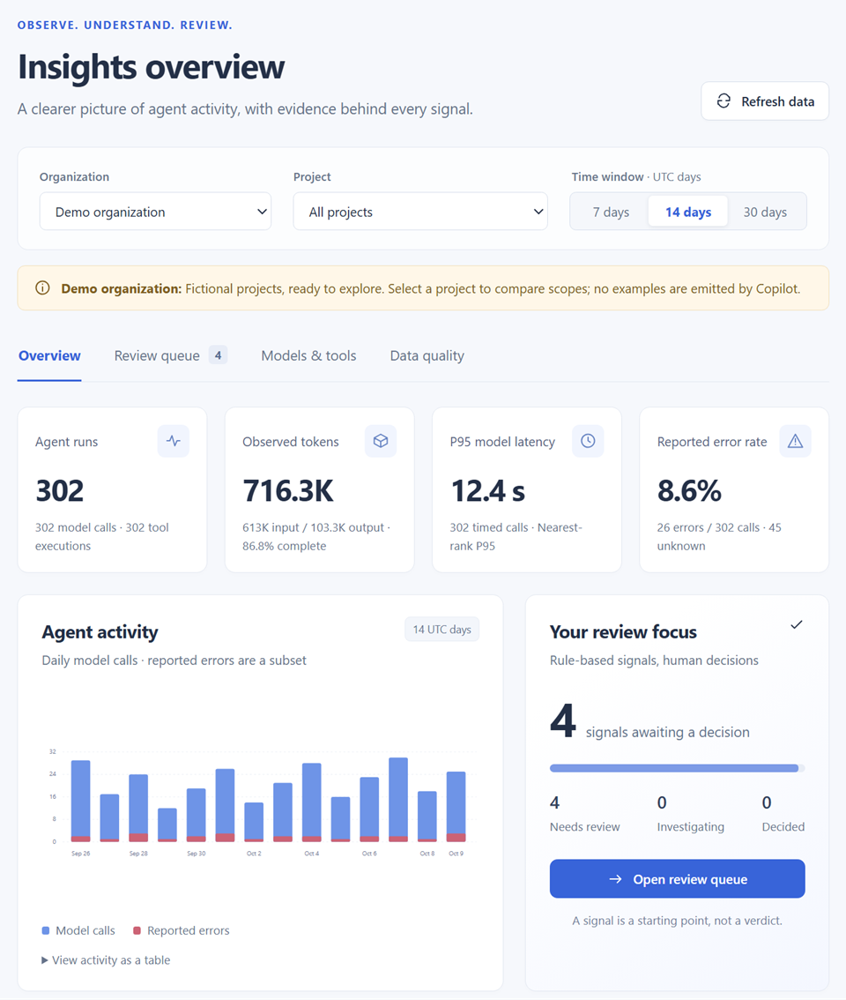
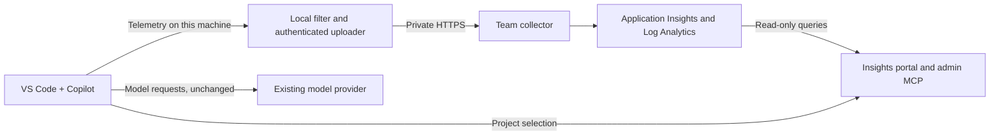

# Copilot Insights

Self-hosted observability for GitHub Copilot agents in VS Code: inspect tool activity, model usage, token counts, and latency using OpenTelemetry.



**Early preview for evaluation.** Synthetic collector tests and earlier native Windows Local Copilot capture/restore checks pass. The new project companion has automated tests, but native multi-window E2E, live Entra access, fleet, privacy, and end-to-end Azure qualification remain open. There is no public hosted offering or production-ready release. See [validation evidence](docs/local-validation.md) and [Project status](#project-status).

## Start here

| Your goal | What you need | Guide |
|---|---|---|
| Try sample data on your machine | Docker with Compose and PowerShell 7.2+; no Azure setup | [Local demo below](#try-it-on-your-machine) |
| Deploy private Azure infrastructure | Resource/RBAC permissions, approved ingestion identity, and a private client connection | [Azure deployment](#deploy-to-azure) and [validation status](docs/azure-validation.md) |
| Understand managed onboarding | An approved Intune-enrolled Windows device and rollout notice; managed package still pending | [Client guide](docs/client-setup.md) |
| Attribute a VS Code window to a project | The project companion's status-bar selector | [Project attribution](docs/projects.md) |
| Analyze reports as an administrator | Local MCP client, or production Entra app-role assignment | [Admin MCP](docs/admin-mcp.md) and [production access](docs/production-access.md) |
| Plan an organization rollout | Intune, Azure, identity/network administrators, and completed release gates | [Intune production plan](docs/intune-deployment.md) and [infrastructure](docs/infrastructure.md) |

## Why Copilot Insights

Copilot in VS Code can [export OpenTelemetry](https://code.visualstudio.com/docs/agents/guides/monitoring-agents), but only as raw data from each editor. To see which models and tools your agents use, how many tokens they consume, and how slow or unreliable they are, you need somewhere to send that data, a safe way to turn export on, and views over the result. Copilot Insights provides all three, on your machine or in your own Azure subscription:

- **Collect:** an OpenTelemetry Collector receives the telemetry, keeps only allow-listed metadata, and assigns the organization. For a remote collector, a local forwarder applies the same filter on the device and authenticates the upload.
- **Display and analyze:** the Insights portal shows usage, latency, errors, model and tool breakdowns, and data quality for an organization or project, and raises rule-based findings for human review. A read-only MCP server returns the same reports to administrators.
- **Set up VS Code:** a reversible script turns on Copilot's export with content and identity capture off, and a companion extension attributes each window to a project. Organization rollout is planned through Intune.

It measures usage and reliability. It does not collect prompts or code, intercept model traffic, or score individual productivity.

This is an early preview. Locally, Docker Compose runs the full path from editor to portal. In Azure, the template deploys the collector and the Entra-protected portal, which reads the stored telemetry from Log Analytics; that cloud path is not yet verified end to end. Filtering has [known gaps](docs/architecture.md#processing-pipeline). See [Project status](#project-status).

## Try it on your machine

The walkthrough has **two separate organizations**: a fictional **Demo organization** that works immediately, and **My VS Code organization**, which receives your local editor's telemetry. No Azure account is needed. The selector changes what you view; it does not route telemetry or create a tenant.

**Prerequisites:** Docker running with Linux containers and Compose. Use PowerShell 7.2+ for the client scripts. A signed-in VS Code with GitHub Copilot is needed only for step 2. No host Node.js installation is required.

If you have not cloned the repository, run `git clone https://github.com/microsoft/copilot-insights.git`, then `cd copilot-insights`. Run the following commands from that folder.

### 1. Set up the service and view the demo organization

```powershell
docker compose -f deploy/local/compose.yaml up --build --detach
docker compose -f deploy/local/compose.yaml ps
```

On Linux, first create the local output directory in Bash with `mkdir -p deploy/local/.data && chmod 777 deploy/local/.data`. That shared-writable directory is only suitable for this disposable evaluation, not a production data store.

**Expected:** two running services: `insights` (the collector, portal, and admin MCP server in one container) and the Aspire `dashboard`. Allow about 30 seconds for the health check.

Open **<http://127.0.0.1:3000/>**. **Demo organization** is selected by default, with sample activity, model/tool breakdowns, and findings ready for human review. Open a finding, expand **IDs & trace**, and try a review decision. The banner clearly labels the organization as fictional; these examples are generated locally, not emitted by Copilot or sent through the collector.

The **Project** dropdown adds **All projects**, **Unattributed**, and two fictional projects, `sample-alpha` and `sample-beta`. Compare them, then open their review queues. Decisions do not transfer between project filters, even when the evidence overlaps with **All projects**.

The **Organization** dropdown contains:

| Organization | Data | What to expect |
|---|---|---|
| Demo organization (`synthetic-demo`) | Independent fictional generator | Populated immediately; never receives editor activity |
| My VS Code organization (`local-vscode`) | Sanitized output from your local collector | Empty on a fresh installation; changes after native Copilot activity |

Switch to **My VS Code organization** and record the baseline before continuing. The new output file is `deploy/local/.data/vscode-telemetry.jsonl`; older evaluation captures are not imported. Existing data in the new file is retained across restarts. Metrics, which open windows re-export continuously, go to a separate rotated `vscode-metrics.jsonl`. An empty organization never silently falls back to the demo.

<a id="optional-connect-vs-code"></a>

### 2. Enable logging and do a small VS Code/Copilot task

Use a disposable folder, not a private repository. Do not change managed policies or telemetry opt-outs. The temporary setup saves your original settings privately and restores them exactly after the test. Do not edit user settings while the test is active.

```powershell
./scripts/setup-client.ps1 Install -Local -Temporary
./scripts/setup-client.ps1 Status

$sampleFolder = Join-Path ([IO.Path]::GetTempPath()) "copilot-insights-sample-$([guid]::NewGuid().ToString('N').Substring(0,8))"
New-Item -ItemType Directory -Path $sampleFolder | Out-Null
'Hello from a disposable Copilot Insights example.' | Set-Content (Join-Path $sampleFolder 'hello.txt')
$extensionPath = (Resolve-Path ./extensions/project-context).Path
docker run --rm --mount "type=bind,source=$extensionPath,target=/extension" --workdir /extension node:24.21.0-alpine@sha256:ebfe2f90462722a7a4de65e91990e97fe0d401c70e0e762c5b53302f905ec1c1 sh -c 'npm ci --ignore-scripts --no-audit --no-fund && npm run compile'
code --new-window --extensionDevelopmentPath $extensionPath $sampleFolder
```

This configures OTLP/HTTP to `http://localhost:4318`, with **content and identity capture off**. It does not disable existing organizational restrictions. Trust only this sample folder if prompted. If reusing an already-open test window, run **Developer: Reload Window** in that window only.

The collector assigns `copilot_insights.organization.id=local-vscode`. Do not add an organization ID to the VS Code settings: client-supplied organization values are overwritten, and choosing a different portal organization cannot move or relabel events.

The source-loaded **Copilot Insights Project Context** extension is written in TypeScript; the `docker run` line compiles it with the same pinned Node image as the portal, so no host Node.js installation is needed. Click **Insights: select project** in the status bar and enter `sample-alpha` for this disposable example. The selection is stored in the sample folder's `.copilot-insights/project.json`, which the companion keeps out of source control. Only the project ID and native window ID are registered; workspace paths, credentials, and the rest of the document are not sent. Other tools can set the project by writing the same file.

**Select the project before doing Copilot work, then accept the reload prompt.** The first selection already applies from that moment; activity from before it stays **Unattributed**, and the reload starts the window's session under the project. Changing to a different project, or clearing it, requires a reload. If VS Code reuses its window ID and the status still requests a reload, close and reopen that sample window. A running window is never rebound to another project. Without a valid selection or completed registration, new activity remains **Unattributed**. [Project attribution](docs/projects.md) explains boundaries, simultaneous windows, and the first-folder rule for multi-root workspaces.

Refresh the portal and select **My VS Code organization → sample-alpha**. Record this project's baseline before the native task. Registering a window does not create telemetry or relabel earlier activity.

In the sample window:

1. Run `Write-Output 'plain-terminal-check'` in its terminal. An ordinary command or file edit by itself is **not** a Copilot agent event.
2. Open Copilot Chat, choose the **Local** harness and **Agent** mode, then submit:

   > Read hello.txt using a file tool, then run Write-Output 'copilot-insights-native-check' using the terminal tool. Do not modify files, access the network, or inspect any other folder. Report the two results.

3. Review any tool approval request and allow only that harmless sample operation. When the response finishes, mark it **Helpful** to exercise a feedback event.

A terminal-only CLI, an Agent Host session, demo data, and `verify.ps1` are not substitutes for this native VS Code/Copilot exercise. Some client versions emit additional background model/tool spans; do not expect every task to produce exactly one model call.

### 3. View your project's new telemetry, then restore settings

Return to the portal, select **My VS Code organization** and the same **Project**, keep the same time window, and select **Refresh data**. Spans should arrive within seconds; allow up to a minute for metrics and feedback export. Choose **Unattributed** to find activity without a safe registered context, including historical captures made before the companion was installed.

- **Overview / Models & tools:** compare agent runs, model calls, executed tools, and observed tokens with the baseline. Missing outcomes remain unknown, not successful.
- **Data quality:** inspect trace IDs, linked child spans, conversation IDs, window/session IDs, and correlated feedback. Trace links open Aspire at `http://127.0.0.1:18888`. These IDs correlate operations, not people.
- **Review queue:** inspect the rule and sanitized evidence. A decision stays with the organization, project filter, and window length; later evidence is flagged **New evidence since review** instead of resetting it.
- Open a second chat in the same sample window: its conversation ID differs, but it uses the same project. A second window on a different workspace can independently select another project.
- Switch back to **Demo organization**: native activity must not appear there, and review decisions must remain separate. Demo totals can vary with the UTC time window, not because of native ingestion.

Always restore your editor settings after the exercise, including when collection fails:

```powershell
./scripts/restore-client.ps1
```

**Expected:** the original settings are verified byte for byte and the temporary snapshot is deleted. Close or reload only the disposable test window to unload its temporary exporter. Restoration returns to the previous configuration, which may itself have telemetry enabled. If settings were edited concurrently, the script refuses to overwrite them; use the [local recovery guidance](docs/client-setup.md#local-development-and-administrator-diagnostics).

If you trusted the sample folder, use **Workspaces: Manage Workspace Trust > Don't Trust** in that sample window before closing it. The [validated organization walkthrough](docs/local-validation.md#earlier-native-organization-walkthrough) records the empty baseline, actual native task, correlation, portal change, and exact settings restoration.

**No new activity?** Check the selected organization, the test window's Local harness and effective settings, `Status`, and collector health (`http://127.0.0.1:13133/`). Check that the window loaded the new settings. Ordinary typing/terminal activity is not a Copilot invocation. Inspect [correlation and collection limits](docs/analytics.md#correlation-ids) before assuming events are missing.

For maintainer-only synthetic collector tests, see [contributing](CONTRIBUTING.md#implementation-checks). `verify.ps1` directly posts tagged OTLP fixtures and must not be described as native client emission or run to manufacture a successful native walkthrough.

### Stop the demo

```powershell
docker compose -f deploy/local/compose.yaml down
```

This stops the local services but keeps telemetry, review decisions, and window registrations. It does not restore VS Code settings: run the restore command first. Do not add `--volumes` unless you intend to delete saved decisions and attribution state.

### Admin MCP and production access

The same service exposes a read-only **Streamable HTTP MCP server** at `http://127.0.0.1:3000/mcp`. It lists organizations/projects and returns the same scoped reports as the portal. Local mode has no authentication. See [client configuration and tools](docs/admin-mcp.md).

**Production is a separate, fail-closed mode:** the UX uses Entra sign-in, and analytics/review APIs plus MCP require the `Insights.Admin` app role. Window registration instead requires `Insights.Publisher`; contributing telemetry does not grant access to reports. [Production access](docs/production-access.md) includes app-registration permissions, server configuration, and an administrator-only role-assignment validator. Entra app roles are not Azure subscription RBAC.

## Deploy to Azure

[](https://portal.azure.com/#create/Microsoft.Template/uri/https%3A%2F%2Fraw.githubusercontent.com%2Fmicrosoft%2Fcopilot-insights%2Fmain%2Fdeploy%2Fazure%2Fazuredeploy.json)

This is the **one-click infrastructure entry point**, not a complete application installation. Register an approved ingestion API first. The default deploys the private network, registry, managed identities, and Azure Monitor storage. An administrator then imports the Copilot Insights image from a [release](https://github.com/microsoft/copilot-insights/releases) (or builds it from source) and redeploys with `deployCollector = true`. After registering the portal's Entra applications, a final redeploy with `deployInsights = true` adds the private, Entra-protected portal and admin MCP, which query the usage workspace with a managed identity. Follow the [Azure deployment and validation guide](docs/infrastructure.md#deploy).

**Validation status:** the isolated Azure validation resources and their active ingestion registration were **removed and verified absent on October 3, 2026**. The collector was healthy before cleanup, but authenticated OTLP delivery, cloud TLS handshakes, stored telemetry, and Azure-backed insights were **not verified**. Read the [historical evidence, cleanup, and remaining gates](docs/azure-validation.md) before treating the template as an end-to-end deployment.

The button reads the published ARM JSON on `main`, not your checkout, and that URL is reachable only while the repository is public. To deploy a private or modified checkout, use the checked-out template via Azure CLI, upload it in the portal, or publish an [Azure-hosted Template Spec deployment link](docs/infrastructure.md#azure-hosted-deployment-link). The badge itself has not been verified as a live end-to-end deployment; an RBAC-protected Template Spec copy passed Azure provider validation in the isolated lab. See [scoped cloud results](docs/azure-validation.md).

For an isolated Windows lab, use the [self-signed HTTPS certificate and trust/rollback workflow](docs/infrastructure.md#development-https-certificate). Keep private keys and deployment parameters outside the repository. The built-in Container Apps hostname already supports HTTPS; a development certificate is only for an explicitly configured custom hostname, not a production trust policy.

## Roll out to a team

**Use Microsoft Intune for the organization production rollout.** Endpoint administrators deploy a qualified client package and Copilot managed policy to staged device groups, own startup/updates/detection/remediation, and perform centralized rollback. Employees follow the [managed client guide](docs/client-setup.md), not repository setup scripts.

Follow the [Intune production plan](docs/intune-deployment.md), [infrastructure guide](docs/infrastructure.md), and [pilot gates](docs/rollout-plan.md#acceptance-criteria). Intune packaging, managed lifecycle, and renewable production **ingestion** authentication remain release gates. The portal/MCP now implement separate [Entra admin authorization](docs/production-access.md), which does not authenticate native OTLP uploads. The diagnostic forwarder's per-user Azure CLI tokens and manual startup are not a production enrollment solution; do not simply run it as `SYSTEM` or distribute tokens through policy.

## How it works



The local demo sends telemetry directly to a local collector, which writes a file that the portal reads instead of Azure storage. One container image, `ghcr.io/microsoft/copilot-insights`, provides the collector, the portal, and the admin MCP server: `COPILOT_INSIGHTS_ROLE` runs all of them (the default, used by the local demo) or only the `collector` or `portal`, which is how the Azure template keeps their identities separate. All profiles reuse the filtering rules in [collector/config/base.yaml](collector/config/base.yaml). See [Architecture](docs/architecture.md) for authentication and storage details.

## Project status

| Area | State |
|---|---|
| Collector filtering | Synthetic tests pass; privacy qualification remains open |
| Docker demo and dashboard | Verified locally on Windows/WSL2, including separate demo/native organizations, native trace and feedback correlation, and exact settings restoration; see the [validation report](docs/local-validation.md) and [CI workflow](.github/workflows/ci.yml) |
| Local analytics and human review | Implemented: collector-file aggregates, isolated fictional demo, evidence views, coverage, and persistent local review decisions; see [analytics](docs/analytics.md) |
| Windows setup and diagnostic forwarder | Local setup and synthetic telemetry tested; target-tenant token issuance checked separately. Forwarder-to-Azure delivery is not yet verified; Azure CLI and manual startup are still required |
| Temporary local setup and restore | Native test uses reversible settings; rollback tests preserve bytes and refuse concurrent edits |
| Intune organization deployment | Production plan documented; signed package, managed lifecycle, and supported authentication still required |
| Private Azure deployment and storage export | Validation deployment and active ingestion identity removed. Historical control-plane checks passed; cloud data-plane and stored-data verification did not complete. See [Azure validation and cleanup](docs/azure-validation.md) |
| Azure-hosted portal and Log Analytics queries | Implemented in the template and tested against the pinned exporter's row mapping; not yet deployed or verified in a live tenant. See [infrastructure](docs/infrastructure.md#deploy-from-your-checkout) |
| Native Local Copilot | Windows VS Code 1.140.0 / Copilot Chat 0.68.0 sample verified; wider version/runtime qualification remains open |
| Automatic client startup, macOS/Linux forwarders | Not implemented |

The [rollout plan](docs/rollout-plan.md#current-status) tracks each milestone.

## Documentation

| Document | Read it to |
|---|---|
| [Client setup](docs/client-setup.md) | Understand managed onboarding/support or run a reversible local test |
| [Intune deployment](docs/intune-deployment.md) | Plan organization-managed policy, packaging, lifecycle, authentication, and rollback |
| [Infrastructure](docs/infrastructure.md) | Deploy shared infrastructure and prepare managed enrollment |
| [Analytics and review](docs/analytics.md) | Inspect local aggregates, review evidence, and understand counting/privacy limits |
| [Data contract](docs/data-contract.md) | Review collected metadata and counting rules |
| [Architecture](docs/architecture.md) | Understand the implementation and its limits |
| [Rollout plan](docs/rollout-plan.md) | Check remaining work, pilot gates, and rollback |
| [Contributing](CONTRIBUTING.md) | Propose a change and run the checks |
| [Security](SECURITY.md) | Report a vulnerability privately |
| [Support](SUPPORT.md) | Ask questions and report issues |
| [Code of conduct](CODE_OF_CONDUCT.md) | Community participation expectations |

## Public references

- [Monitor agent usage with OpenTelemetry](https://code.visualstudio.com/docs/agents/guides/monitoring-agents)
- [OpenTelemetry Collector](https://opentelemetry.io/docs/collector/)
- [OTel GenAI semantic conventions](https://opentelemetry.io/docs/specs/semconv/gen-ai/)

## Contributing

This project welcomes contributions and suggestions. Most contributions require agreement to a Contributor License Agreement (CLA) declaring that you have the right to grant the rights to your contribution. See [Contributor License Agreements](https://cla.opensource.microsoft.com).

When you submit a pull request, the CLA bot determines whether a CLA is required and provides instructions. You only need to complete this once across repositories that use the same CLA process. Read [CONTRIBUTING.md](CONTRIBUTING.md) before proposing a change.

This project follows the [Microsoft Open Source Code of Conduct](https://opensource.microsoft.com/codeofconduct/). See the [Code of Conduct FAQ](https://opensource.microsoft.com/codeofconduct/faq/) or contact [opencode@microsoft.com](mailto:opencode@microsoft.com) with questions.

## Trademarks

This project may contain trademarks or logos for projects, products, or services. Authorized use of Microsoft trademarks or logos is subject to the [Microsoft Trademark and Brand Guidelines](https://www.microsoft.com/legal/intellectualproperty/trademarks/usage/general). Modified versions must not cause confusion or imply Microsoft sponsorship. Third-party trademarks and logos remain subject to their respective policies.

## License

[MIT](LICENSE).
