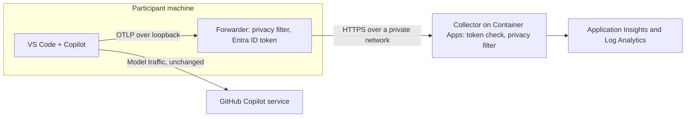

# Copilot Insights

See how your teams use GitHub Copilot agents in Visual Studio Code: which tools and models they use, how many tokens they consume, and how fast and reliable agent runs are. Copilot Insights does this without collecting prompts, code, or personal identities.

**Status: early preview.** Everything here runs and is tested with synthetic telemetry, but it has not been used with real participants or deployed to Azure by the maintainers yet. See [Project status](#project-status).

## Why Copilot Insights

Copilot in VS Code can [export OpenTelemetry](https://code.visualstudio.com/docs/agents/guides/monitoring-agents) traces, metrics, and events, using OTLP, the OpenTelemetry protocol. That is the right raw material for questions like "which agent tools do we depend on?" or "are agent runs getting slower?". Turning it on for a team raises questions the export alone does not answer:

- **What leaves each machine?** Even with content capture off, the export can include repository URLs, branch names, and free-text names. With content capture on, it includes prompts, code, and tool output.
- **Who may send data, and where does it go?** Copilot sends to whatever endpoint is configured and attaches no credential of its own.
- **How do people turn it on, check it, and turn it off** without hand-editing settings?

Copilot Insights answers them with a small system built from standard parts:

| Concern | What Copilot Insights does |
|---|---|
| Privacy | A [data contract](docs/data-contract.md) enforced by an OpenTelemetry Collector pipeline: only approved signals and fields pass, free-text values are replaced, and content and identity capture stay off. The pipeline runs on the participant's machine and again on the server. |
| Trust | The central collector accepts only Microsoft Entra ID tokens issued for your ingestion app. Participants never handle a secret: a local forwarder gets tokens from their Azure CLI sign-in. |
| Private network | The Azure deployment has no public endpoints: an internal Container Apps environment and private endpoints for the registry and Azure Monitor. |
| Simple setup | One script installs, checks, pauses, and removes the client side, and changes only a marked block in the VS Code settings. |
| Proof | A verification script sends telemetry with canary values in every excluded field and fails if any canary gets through. |

### What you can learn

- Which agent tools run, how often, and how often they fail.
- Token consumption by model, including cached and reasoning tokens.
- Model latency and time to first token.
- Response feedback (thumbs up or down) and edit acceptance.
- Adoption and trends per cohort, such as a team or a pilot ring.

### What it does not do

- Collect prompts, responses, code, file paths, repository or branch names, account names, or machine names.
- Sit in the path of model requests. Copilot talks to its model provider exactly as before.
- Score individual productivity, or prove that a task was completed.

## How it works



The same collector runs in every role: as the local quick start, as the forwarder next to VS Code, and as the central service. Only the profile in [collector/config](collector/config) differs, so the filters you test locally are the filters that run in production.

## Design principles

1. **Do not intercept model traffic.** The collector receives telemetry, not inference requests.
2. **Minimize data before it leaves the machine.** Turning off content capture does not remove every sensitive field, so the forwarder applies the allow-list on the device and the server applies it again.
3. **Authenticate explicitly.** An endpoint URL is not a credential. The forwarder adds a short-lived Entra ID token; the server validates issuer and audience.
4. **Count what is actually observed.** Separate parent and child operations, retries, missing signals, and unsupported runtimes.
5. **Keep telemetry non-blocking.** If the forwarder or collector is down, Copilot keeps working and nothing is sent.
6. **Make setup reversible.** Change only a marked settings block, respect telemetry opt-outs and policy, and remove everything on uninstall.

## Try it on your machine

This takes about ten minutes. You need Docker with Compose and PowerShell 7.2 or later. Telemetry stays on your machine, and no Azure resources or sign-in are needed. To join a team pilot instead, follow [Client setup](docs/client-setup.md).

1. **Start the collector and a dashboard.**

   ```powershell
   docker compose -f deploy/local/compose.yaml up --build --detach
   ```

   On Linux, first run `mkdir -p deploy/local/.data && chmod 777 deploy/local/.data` so the collector, which runs as UID 10001, can write its output file.

2. **Check the privacy pipeline.**

   ```powershell
   ./scripts/verify.ps1
   ```

   The script sends synthetic traces, metrics, and logs with canary values hidden in excluded fields, then inspects what the collector wrote to `deploy/local/.data/telemetry.jsonl`. Every line should start with `PASS`, followed by `Verification passed`.

3. **Connect VS Code.**

   ```powershell
   ./scripts/setup-client.ps1 Install -Local
   ```

   This adds a marked block of Copilot settings to your VS Code user settings, with content and identity capture off. Then reload VS Code windows (Command Palette: **Developer: Reload Window**).

4. **Use Copilot and look at the result.** Run a task in agent mode, then open the dashboard at <http://localhost:18888>. You should see `invoke_agent`, `chat`, and `execute_tool` traces that carry only approved fields.

5. **Clean up.**

   ```powershell
   ./scripts/setup-client.ps1 Uninstall
   docker compose -f deploy/local/compose.yaml down
   ```

The local profile has no authentication, so every port is published on `127.0.0.1` only. Do not expose it to other machines.

## Roll out to a team

1. An administrator registers the ingestion app and deploys the private collector to Azure: [Infrastructure](docs/infrastructure.md).
2. Each participant runs one command on their Dev Box or Windows workstation: [Client setup](docs/client-setup.md).
3. The pilot owner follows the [rollout plan](docs/rollout-plan.md) for gates, collection notice, and rollback.

Do not collect from real users until your organization has reviewed authentication, the data contract, storage access, retention, and the collection notice. Examples use reserved example domains and fictitious identifiers; never commit credentials or deployment-specific values.

## Project status

| Area | State |
|---|---|
| Privacy pipeline enforcing the proposed [data contract](docs/data-contract.md): allow-lists, value validation, organization label | Implemented; checked with canary telemetry. The contract itself still needs your organization's review. |
| Local quick start with dashboard | Implemented; run by the CI workflow on every change |
| Client setup script and local forwarder (Windows) | Implemented; tested end to end locally against real Entra ID token validation |
| Private Azure deployment (Bicep) | Implemented; builds and lints cleanly; not yet deployed by the maintainers |
| Export to Application Insights with a managed identity | Configured; not yet verified in Azure |
| Exports from real Copilot clients; supported-version matrix | Not yet validated |
| Analytics views such as workbooks | Not started |
| Forwarder start at sign-in; forwarder on macOS and Linux | Not started |

The [rollout plan](docs/rollout-plan.md#current-status) tracks each milestone.

## Repository layout

| Path | Contents |
|---|---|
| [collector](collector) | Collector image: shared privacy pipeline (`base.yaml`) and the `local`, `forwarder`, and `azure` profiles |
| [deploy/local](deploy/local) | Docker Compose quick start with the collector and a dashboard |
| [deploy/azure](deploy/azure) | Bicep template for the private Container Apps deployment |
| [scripts/setup-client.ps1](scripts/setup-client.ps1) | Client setup: install, start, stop, status, and uninstall |
| [scripts/verify.ps1](scripts/verify.ps1) | Synthetic telemetry and privacy verification, locally or against a deployment |
| [scripts/tests](scripts/tests) | Tests for the setup script |
| [docs](docs) | Architecture, data contract, infrastructure, client setup, and rollout plan |

## Documentation

| Document | Read it to |
|---|---|
| [Client setup](docs/client-setup.md) | Connect your VS Code, check it, and remove it again |
| [Data contract](docs/data-contract.md) | See exactly what is kept, what is removed, and how values are counted |
| [Architecture](docs/architecture.md) | Understand the client, forwarder, authentication, collection, and storage boundaries |
| [Infrastructure](docs/infrastructure.md) | Register the ingestion app, deploy the private Azure topology, and troubleshoot it |
| [Rollout plan](docs/rollout-plan.md) | Run a pilot: milestones, current status, gates, and rollback |
| [Contributing](CONTRIBUTING.md) | Propose a change and run the checks |
| [Security](SECURITY.md) | Report a vulnerability privately |
| [Support](SUPPORT.md) | Ask questions and report issues |
| [Code of conduct](CODE_OF_CONDUCT.md) | Community participation expectations |

The repository is prepared for review before an open-source release. Repository visibility, organization approval, and release readiness are separate from the choice of license.

## Public references

- [Monitor agent usage with OpenTelemetry](https://code.visualstudio.com/docs/agents/guides/monitoring-agents)
- [OpenTelemetry Collector](https://opentelemetry.io/docs/collector/)
- [OTel GenAI semantic conventions](https://opentelemetry.io/docs/specs/semconv/gen-ai/)

## Contributing

This project welcomes contributions and suggestions. Most contributions require agreement to a Contributor License Agreement (CLA) declaring that you have the right to grant the rights to your contribution. See [Contributor License Agreements](https://cla.opensource.microsoft.com).

When you submit a pull request, the CLA bot determines whether a CLA is required and provides instructions. You only need to complete this once across repositories that use the same CLA process. Read [CONTRIBUTING.md](CONTRIBUTING.md) before proposing a change.

This project follows the [Microsoft Open Source Code of Conduct](https://opensource.microsoft.com/codeofconduct/). See the [Code of Conduct FAQ](https://opensource.microsoft.com/codeofconduct/faq/) or contact [opencode@microsoft.com](mailto:opencode@microsoft.com) with questions.

## Trademarks

This project may contain trademarks or logos for projects, products, or services. Authorized use of Microsoft trademarks or logos is subject to the [Microsoft Trademark and Brand Guidelines](https://www.microsoft.com/legal/intellectualproperty/trademarks/usage/general). Modified versions must not cause confusion or imply Microsoft sponsorship. Third-party trademarks and logos remain subject to their respective policies.

## License

[MIT](LICENSE).