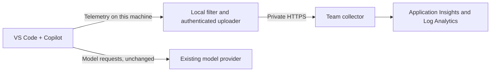

# Copilot Insights

Self-hosted observability for GitHub Copilot agents in VS Code: inspect tool activity, model usage, token counts, and latency using OpenTelemetry.

**Early preview for evaluation.** Synthetic collector tests and one native Windows Local Copilot capture/restore test pass; fleet, privacy, and end-to-end Azure qualification remain open. There is no public hosted offering or production-ready release. See [Project status](#project-status).

## Start here

| Your goal | What you need | Guide |
|---|---|---|
| Try sample data on your machine | Docker with Compose and PowerShell 7.2+; no Azure setup | [Local demo below](#try-it-on-your-machine) |
| Deploy private Azure infrastructure | Resource/RBAC permissions, approved ingestion identity, and a private client connection | [Azure deployment](#deploy-to-azure) and [validation status](docs/azure-validation.md) |
| Understand managed onboarding | An approved Intune-enrolled Windows device and rollout notice; managed package still pending | [Client guide](docs/client-setup.md) |
| Plan an organization rollout | Intune, Azure, identity/network administrators, and completed release gates | [Intune production plan](docs/intune-deployment.md) and [infrastructure](docs/infrastructure.md) |

## Why Copilot Insights

Copilot already [exports OpenTelemetry](https://code.visualstudio.com/docs/agents/guides/monitoring-agents). This project adds metadata filtering before off-device uploads, authenticated ingestion, a reversible setup script, and a private Azure deployment template. You do not need to build a model-traffic proxy or manually give each participant an access token.

The goal is to understand usage and reliability, not collect conversations or score individual productivity. Content and identity capture are off in the generated settings. Filtering is still a preview with [known gaps](docs/architecture.md#processing-pipeline), so use synthetic data until your collection policy and pilot validation are approved.

## Try it on your machine

Start with synthetic data. You need Docker running with Linux containers and Compose, plus PowerShell 7.2 or later (`pwsh`). You do not need Copilot, Azure, or to change editor settings for this demo.

Follow the order **build/deploy → observe a baseline → send a dummy fixture → observe the difference → optionally perform real VS Code/Copilot actions → observe again**. The fixture command sends OTLP directly to the collector; it does **not** create events inside a Copilot process or prove real-client export works.

1. **Get the repository.** In PowerShell 7, run:

   ```powershell
   git clone https://github.com/microsoft/copilot-insights.git
   cd copilot-insights
   ```

   Already have it? Open PowerShell 7 in that folder instead. Without Git, use GitHub's **Code > Download ZIP**, extract it, and open the extracted folder. Run all following commands from the repository folder.

2. **Build and deploy first. Do not send telemetry yet.**

   On Linux only, first run `mkdir -p deploy/local/.data && chmod 777 deploy/local/.data` in Bash. This lets the container write its output; the directory is shared-writable, so use it only for this synthetic demo.

   ```powershell
   docker compose -f deploy/local/compose.yaml up --build --detach
   docker compose -f deploy/local/compose.yaml ps
   ```

   **Expected result:** the collector, Aspire dashboard, and insights service are running; the insights service becomes healthy. Building or starting the stack does not generate Copilot activity.

3. **Observe the portal before the test:** <http://127.0.0.1:3000/?source=local&days=7&view=overview>.

   Select **Local collector**, keep **7 days** selected, and click **Refresh data**. Note the agent runs, model calls, tool executions, observed tokens, and reported errors. A new installation has no collected activity; an existing installation can have earlier samples. Compare against your baseline rather than assuming zero.

   Do **not** select **Synthetic demo** for this comparison. That source is an independent fictional dataset, not a view of the collector, and does not change when you use VS Code or send fixtures.

4. **Send a dummy telemetry fixture and verify the pipeline.**

   ```powershell
   ./scripts/verify.ps1 -TimeoutSeconds 60
   ```

   **Expected result:** the script identifies itself as a synthetic emitter, prints `PASS` checks, and ends with `Verification passed`. It uses documented `invoke_agent`, `chat`, and `execute_tool` spans, GenAI duration/token histograms, tool/feedback counters, and feedback log events. It also injects deliberate secret canaries and rejected-record controls to test filtering; those controls are not claims about normal Copilot output. See [signal compatibility and provenance](docs/data-contract.md#signal-compatibility-and-fixture-provenance).

5. **Refresh the portal and compare with step 3.**

   Keep the same **Local collector** source and time window. After one successful fixture run, with no other new activity, expect these differences:

   | Portal measure | Change from your baseline |
   |---|---|
   | Agent runs | +1 |
   | Model calls | +1 |
   | Tool executions | +1 |
   | Observed tokens | +1,380: 1,200 input and 180 output |
   | Reported model errors | +1, deliberately injected |

   The error signal is intentional, not a real Copilot failure. Inspect **Models & tools** for `example-model` / `readFile`, and **Review queue** for the error evidence. Latency percentiles and error percentages depend on the previous data and need not increase. The portal does not double-count parent-agent tokens or independent metric samples.

   **Raw diagnostics:** open <http://127.0.0.1:18888/traces> to inspect the correlated trace. Span names are normalized by the privacy filter. In Aspire Metrics, inspect the histogram/counter instruments; Structured Logs contains the permitted feedback event with its body cleared. These are synthetic fixtures even though they traveled through the real collector. The [analytics guide](docs/analytics.md) explains the views and counting rules.

If verification fails, check that Docker is running and inspect `docker compose -f deploy/local/compose.yaml logs collector`. Do not enable real-client export to troubleshoot a failed synthetic test.

### Optional: connect VS Code

This is a **separate, opt-in real-client test**, not something the fixture command performs. On Windows, you need VS Code with Copilot access and permission to enable metadata export. Use only a disposable project and harmless prompts; keep internal repositories, credentials, and unrelated work closed.

1. **Enable temporary local export explicitly**, from this repository in PowerShell 7:

   ```powershell
   ./scripts/setup-client.ps1 Install -Local -Temporary
   ./scripts/setup-client.ps1 Status
   ```

   You can add `-WhatIf` to preview it. This temporarily changes your **normal VS Code user settings**, not an isolated profile, and affects windows using those settings. It sets OTLP/HTTP to the deployed loopback collector, with content and identity capture off. Existing user OTel preferences are saved for exact restoration; an installed client, disabled VS Code telemetry, or conflicting policy/environment routing stops the test. Do not bypass those restrictions. `Status` checks configuration/reachability, not actual native export.

   **Do not edit user settings during the test.** A private full-settings snapshot is kept under `%LOCALAPPDATA%\CopilotInsights` until restoration. Do not share it or place a custom `-InstallRoot` in source control. Prepare to run `restore-client.ps1` in step 7 even if an earlier step fails.

2. **Open a disposable folder.** The following creates a fictional text file outside the repository:

   ```powershell
   $samplePath = Join-Path ([IO.Path]::GetTempPath()) ('copilot-insights-sample-' + [Guid]::NewGuid().ToString('N'))
   New-Item -ItemType Directory -Path $samplePath | Out-Null
   Set-Content -LiteralPath (Join-Path $samplePath 'hello.txt') -Value 'Hello from a disposable telemetry test.'
   Write-Output $samplePath
   code --new-window $samplePath
   ```

   If `code` is not on PATH, use **File > Open Folder** to open the displayed `$samplePath`. Save work and run **Developer: Reload Window** in the test window. Use a **Local Copilot Chat** session in **Agent** mode, not Agent Host, a CLI terminal session, a cloud/background agent, or a remote window; those paths need separate qualification.

3. **Take another portal baseline, then try an ordinary terminal command.** Refresh **Local collector** with the same time window. In the sample window's PowerShell terminal, run:

   ```powershell
   Write-Output 'copilot-insights-manual-control'
   ```

   This command alone is not a Copilot operation and should not add agent/model/tool spans. Opening a file or typing in the editor is not an LLM request either. Background exports from earlier activity can still arrive, so let previous work finish before comparing.

4. **Ask Copilot to perform the dummy operation.** Submit this prompt in the Local Agent chat:

   > Read hello.txt using a file tool. Then run `Write-Output 'copilot-insights-agent-check'` in the PowerShell terminal. Do not modify files, invoke subagents, read other files, or use network tools. Summarize what you did.

   Review any tool approval and approve only the harmless action you requested. Here the **Copilot process**, rather than a fixture script, should emit agent, model-call, and tool-execution spans. The number of calls and reported tokens depends on the actual agent execution; do not expect the fixture's exact counts.

5. **Optionally exercise edit and response feedback.** Ask Copilot to change only `hello.txt` to `Hello from the edited telemetry sample.` Review and accept or reject the proposed edit, and optionally use the chat response's thumbs-up/down control. Where supported by that client, these produce edit/feedback metrics and events. Inspect them in Aspire Metrics/Structured Logs. The portal currently aggregates spans, not feedback scores; its own review decisions are also separate from Copilot feedback.

6. **Observe the portal again and verify native provenance.** After the agent finishes, allow time for export/batching (up to about a minute), then click **Refresh data** with the same source and time window. Compare model/tool calls, observed tokens, the current day's activity, and available evidence with the second baseline. New error/review signals are not guaranteed for a successful task; missing measurements remain unknown.

   In Aspire Traces, find the new `copilot-chat` trace from the test time, with the installed extension's `service.version` and correlated `invoke_agent`, `chat`, and `execute_tool` spans. The fixture version is `0.0.0-verification`; seeing only that version or `example-model` does **not** verify a real client. Keep collected metadata local; do not commit raw telemetry or diagnostic exports.

   If nothing changes, check **Local collector** versus **Synthetic demo**, refresh the page, check `Status` and collector health, verify that the test window was reloaded, and confirm the Local harness and its effective settings. A successful dummy fixture or an enabled setting alone is not native-client validation. See [client troubleshooting](docs/client-setup.md#troubleshooting) and [validation limits](docs/local-validation.md#not-qualified-by-this-run).

7. **Restore the original settings, including after a failed test.**

   ```powershell
   ./scripts/restore-client.ps1
   ```

   **Expected result:** original settings verified byte for byte and the temporary snapshot deleted. Close or reload only the test window to discard its temporary exporter configuration; do not interrupt other editor sessions. Restoration returns to your previous configuration, which may itself have telemetry enabled. If settings changed during the test, restoration refuses to overwrite them; follow [local recovery guidance](docs/client-setup.md#local-development-and-administrator-diagnostics).

**Verified example:** on October 3, 2026 UTC (October 2, 2026 PDT), VS Code 1.140.0 / Copilot Chat 0.68.0 emitted native agent/model/file/terminal spans, nine metric families, and a response-feedback event. Portal totals changed from 5 to 6 agent runs, 5 to 15 model calls, and 6,900 to 119,925 observed tokens; the native extension also made auxiliary model/tool calls. Settings were restored exactly. See the [scoped evidence and limits](docs/local-validation.md#native-client-emission-and-restoration), not a fixed expected count for your own task.

After restarting your machine, make sure Docker and the demo containers are running before another test. Local mode does not use the setup script's `Start` or `Stop` actions.

### Stop the demo

```powershell
docker compose -f deploy/local/compose.yaml down
```

If you used the temporary native test, run `./scripts/restore-client.ps1` and close or reload its window. For an older non-temporary marked-block installation, use `./scripts/setup-client.ps1 Uninstall` instead. Stopping containers leaves local output in `deploy/local/.data`; remove that generated directory when you no longer need it. You can also delete the disposable sample folder; review decisions remain in the separate Docker volume.

The local demo has no authentication. Keep its ports bound to `127.0.0.1`; do not expose it to other machines.

## Deploy to Azure

[](https://portal.azure.com/#create/Microsoft.Template/uri/https%3A%2F%2Fraw.githubusercontent.com%2Fmicrosoft%2Fcopilot-insights%2Fmain%2Fdeploy%2Fazure%2Fazuredeploy.json)

This is the **one-click infrastructure entry point**, not a complete application installation. Register an approved ingestion API first. The default deploys the private network, registry, managed identity, and Azure Monitor storage; then an administrator builds/pushes the collector image and redeploys with `deployCollector = true`. The local human-review portal is **not** deployed or connected to Azure by this template. Follow the [Azure deployment and validation guide](docs/infrastructure.md#deploy).

**Validation status:** an isolated private Azure collector is running with the intended ingestion identity and custom-certificate binding. Authenticated OTLP delivery, cloud TLS handshakes, stored telemetry, and Azure-backed insights are **not yet verified**; the validation runner blocked the data-plane probes. Read the [evidence and remaining gates](docs/azure-validation.md) before treating this as an end-to-end deployment.

The button reads the published ARM JSON on `main`, not your checkout. **Publication gate:** the new template URL returned HTTP 404 during the October 3, 2026 UTC check. Until this change is published, use the checked-out template via Azure CLI, upload it in the portal, or publish an [Azure-hosted Template Spec deployment link](docs/infrastructure.md#azure-hosted-deployment-link); do not treat the GitHub badge as a validated live deployment. An RBAC-protected Template Spec copy passed Azure provider validation in the isolated lab. See [scoped cloud results](docs/azure-validation.md).

For an isolated Windows lab, use the [self-signed HTTPS certificate and trust/rollback workflow](docs/infrastructure.md#development-https-certificate). Keep private keys and deployment parameters outside the repository. The built-in Container Apps hostname already supports HTTPS; a development certificate is only for an explicitly configured custom hostname, not a production trust policy.

## Roll out to a team

**Use Microsoft Intune for the organization production rollout.** Endpoint administrators deploy a qualified client package and Copilot managed policy to staged device groups, own startup/updates/detection/remediation, and perform centralized rollback. Employees follow the [managed client guide](docs/client-setup.md), not repository setup scripts.

Follow the [Intune production plan](docs/intune-deployment.md), [infrastructure guide](docs/infrastructure.md), and [pilot gates](docs/rollout-plan.md#acceptance-criteria). Intune packaging, managed lifecycle, and production authentication are not implemented yet. The diagnostic forwarder's per-user Azure CLI tokens and manual startup are not a production enrollment solution; do not simply run it as `SYSTEM` or distribute tokens through policy.

## How it works



The local demo replaces the cloud destination with a dashboard and output file. All profiles reuse the filtering rules in [collector/config/base.yaml](collector/config/base.yaml). See [Architecture](docs/architecture.md) for authentication and storage details.

## Project status

| Area | State |
|---|---|
| Collector filtering | Synthetic tests pass; privacy qualification remains open |
| Docker demo and dashboard | Verified locally on Windows/WSL2 with synthetic and one native Local Copilot exercise; see the [validation report](docs/local-validation.md) and [CI workflow](.github/workflows/ci.yml) |
| Local analytics and human review | Implemented: collector-file aggregates, isolated fictional demo, evidence views, coverage, and persistent local review decisions; see [analytics](docs/analytics.md) |
| Windows setup and diagnostic forwarder | Local setup and synthetic telemetry tested; target-tenant token issuance checked separately. Forwarder-to-Azure delivery is not yet verified; Azure CLI and manual startup are still required |
| Temporary local setup and restore | Native test uses reversible settings; rollback tests preserve bytes and refuse concurrent edits |
| Intune organization deployment | Production plan documented; signed package, managed lifecycle, and supported authentication still required |
| Private Azure deployment and storage export | Private collector running; target-tenant token issuance, source image layer, and certificate binding checked. Cloud data-plane and stored-data verification remain blocked. See [Azure validation](docs/azure-validation.md) |
| Native Local Copilot | Windows VS Code 1.140.0 / Copilot Chat 0.68.0 sample verified; wider version/runtime qualification remains open |
| Shared/authenticated team analytics, automatic client startup, macOS/Linux forwarders | Not implemented |

The [rollout plan](docs/rollout-plan.md#current-status) tracks each milestone.

## Documentation

| Document | Read it to |
|---|---|
| [Client setup](docs/client-setup.md) | Understand managed onboarding/support or run a reversible local test |
| [Intune deployment](docs/intune-deployment.md) | Plan organization-managed policy, packaging, lifecycle, authentication, and rollback |
| [Infrastructure](docs/infrastructure.md) | Deploy shared infrastructure and prepare managed enrollment |
| [Analytics and review](docs/analytics.md) | Inspect local aggregates, review evidence, and understand counting/privacy limits |
| [Data contract](docs/data-contract.md) | Review collected metadata and counting rules |
| [Architecture](docs/architecture.md) | Understand the implementation and its limits |
| [Rollout plan](docs/rollout-plan.md) | Check remaining work, pilot gates, and rollback |
| [Contributing](CONTRIBUTING.md) | Propose a change and run the checks |
| [Security](SECURITY.md) | Report a vulnerability privately |
| [Support](SUPPORT.md) | Ask questions and report issues |
| [Code of conduct](CODE_OF_CONDUCT.md) | Community participation expectations |

The repository is prepared for review before an open-source release. Repository visibility, organization approval, and release readiness are separate from the choice of license.

## Public references

- [Monitor agent usage with OpenTelemetry](https://code.visualstudio.com/docs/agents/guides/monitoring-agents)
- [OpenTelemetry Collector](https://opentelemetry.io/docs/collector/)
- [OTel GenAI semantic conventions](https://opentelemetry.io/docs/specs/semconv/gen-ai/)

## Contributing

This project welcomes contributions and suggestions. Most contributions require agreement to a Contributor License Agreement (CLA) declaring that you have the right to grant the rights to your contribution. See [Contributor License Agreements](https://cla.opensource.microsoft.com).

When you submit a pull request, the CLA bot determines whether a CLA is required and provides instructions. You only need to complete this once across repositories that use the same CLA process. Read [CONTRIBUTING.md](CONTRIBUTING.md) before proposing a change.

This project follows the [Microsoft Open Source Code of Conduct](https://opensource.microsoft.com/codeofconduct/). See the [Code of Conduct FAQ](https://opensource.microsoft.com/codeofconduct/faq/) or contact [opencode@microsoft.com](mailto:opencode@microsoft.com) with questions.

## Trademarks

This project may contain trademarks or logos for projects, products, or services. Authorized use of Microsoft trademarks or logos is subject to the [Microsoft Trademark and Brand Guidelines](https://www.microsoft.com/legal/intellectualproperty/trademarks/usage/general). Modified versions must not cause confusion or imply Microsoft sponsorship. Third-party trademarks and logos remain subject to their respective policies.

## License

[MIT](LICENSE).
