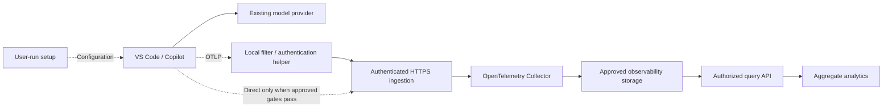

# Architecture

Status: proposed design. No components described here have been implemented in this repository.

## System boundaries

Copilot Insights observes instrumented agent activity through OpenTelemetry. It does not intercept inference traffic, alter model selection, or replace the user's model-provider subscription.

The local helper is a proposed component, not an existing Copilot feature. It becomes a prerequisite when native export cannot satisfy pre-export filtering or credential-lifecycle requirements. A successful laboratory test of direct export does not establish that every runtime can use the same configuration.

## Client and local helper

The first candidate client is a supported Windows VS Code instance using the Local harness. Agent Host, terminal CLI, remote extension hosts, and other operating systems qualify independently. Record exact versions and tested signals.

The user-run setup package should configure a dedicated user-owned editor instance, preserve unrelated settings, and offer status, disable, and restore operations. Static organization/cohort tags are configuration labels, not authenticated identity or active-project context.

If required, a local helper should:

- Bind only to its approved loopback interface and protect against unintended local senders.
- Apply the approved field/value allow-list before off-device transmission.
- Acquire, protect, renew, and revoke outbound credentials through an approved identity flow.
- Keep credentials out of the editor environment, tool subprocesses, logs, and configuration examples.
- Bound buffering and retry lifetimes, with no raw telemetry persistence.
- Fail visibly without blocking ordinary development work.

Loopback is not proof of process identity. Threat-model other processes running under the same user and prevent the helper from becoming an unrestricted authenticated proxy.

## Ingestion protocol

Use OTLP over HTTP, initially with a tested protobuf configuration. An illustrative external base URL is `https://telemetry.example.org/otlp`; its signal paths are:

- `/otlp/v1/traces`
- `/otlp/v1/metrics`
- `/otlp/v1/logs`

These are examples, not live endpoints. Configure reverse-proxy path rewriting explicitly and verify each signal. Do not route telemetry through a browser application, interactive login redirect, or HTML error handler.

Ingress must enforce authentication and authorization, TLS, request/decompression limits, rate limits, and valid content types. Backend receiver ports must remain private. Access and diagnostic logs must not contain credentials or request bodies.

## Authentication

An endpoint URL alone provides no client credential. Copilot does not automatically attach a collector-specific token or a browser session. Enabling identity capture adds telemetry attributes; it does not authenticate the connection.

| Option | Capability | Work still required |
|---|---|---|
| Native explicit headers | The documented exporter supports `OTEL_EXPORTER_OTLP_HEADERS` | Safe provisioning, expiry/renewal, runtime support, and subprocess-secret exposure checks |
| Local authenticated helper | A separate process can own upload authentication and filtering | Implementation, supported enrollment, credential protection/renewal, local isolation, and packaging |
| Network restriction alone | Limits where connections can originate | Does not establish individual sender identity and does not satisfy the authenticated-ingestion requirement |

Supplying a bearer header does not implement OAuth or token refresh. A token obtained once at startup eventually expires. Do not reuse a model-provider token for a different audience or distribute one long-lived secret to every participant.

For an OAuth/OIDC design, validate signature, issuer, intended audience, lifetime, and authorized scopes/roles. Bind allowed organization/storage scope from a server-controlled enrollment mapping, not a request attribute. A valid credential authenticates an uploader, not the truth of its telemetry.

Copilot's documented managed-header behavior differs between Chat and Agent Host. Verify the selected mechanism for each runtime. Managed settings or a setup script do not, by themselves, solve authentication.

## Processing pipeline

Use a version-pinned, approved OpenTelemetry Collector distribution and supported processors/exporters where possible. The conceptual order is:

1. Authenticate and authorize the request at the trusted ingress boundary.
2. Decode OTLP and enforce resource and schema limits.
3. Validate field names and values across resources, scopes, spans, events, links, log bodies, and metrics.
4. Remove prohibited data and attach approved source/schema and authorization-derived context.
5. Batch and enqueue only sanitized records.
6. Export through the selected backend adapter with bounded retries.

Source-side filtering and server filtering have different guarantees: server filtering protects retained data, while only source-side controls can prevent prohibited fields from leaving the device.

The Collector is a processing service, not the long-term database. Do not archive unrestricted raw payloads for hypothetical future analysis. Disable payload debugging in ingress, authentication components, and the collector.

## Storage

Keep the receiver OTLP-based and the analytics schema explicit so deployments can select an appropriate backend. A backend must meet the approved retention, access, regional hosting, deletion, and cost requirements.

### Azure Monitor reference option

A proposed Azure deployment uses the Azure Monitor exporter to upload records to a workspace-based Application Insights resource, with durable query storage in its linked Log Analytics workspace. Use server-side exporter configuration and a separately reviewed collector-to-Azure authentication method. Clients must not receive backend storage credentials.

The upstream exporter documents these mappings; verify them against the pinned release:

| OTel input | Workspace table | Important condition |
|---|---|---|
| `CLIENT`, `PRODUCER`, and `INTERNAL` spans | `AppDependencies` | Selected by span kind, not only the operation name |
| `SERVER` and `CONSUMER` spans | `AppRequests` | These describe emitted spans, not automatically the receiver's HTTP requests |
| Ordinary log records | `AppTraces` | Application Insights calls log records traces; distributed spans use other tables |
| Explicitly marked custom-event logs | `AppEvents` | Requires the exporter option and a supported marker |
| Supported metrics | `AppMetrics` | Validate units, types, cumulative/delta behavior, and histogram translation |

Do not assume a generic histogram preserves buckets or exact percentiles through translation. Verify token attributes, resource tags, and operation/parent correlations using synthetic fixtures. Generative-AI content tables must remain empty for this project's source because content collection is out of scope.

No separate relational database, raw-data object archive, or message broker is required by the initial proposal. Add infrastructure only when measured requirements justify it.

### Queues are not durable analytics storage

An in-memory sending queue can lose data on process failure. A secured persistent queue improves restart recovery but still has finite capacity, retry expiry, and disk-failure risks. Only sanitized data may enter a durable queue.

An OTLP success response is not proof that every item is already stored and queryable downstream. Respect partial-success semantics, track drops and export failures, and use a synthetic end-to-end query probe for ingestion delay. Do not promise exactly-once delivery.

## Query and dashboard boundary

An authorized backend queries the selected store and returns aggregates. The browser must not receive storage credentials. Enforce organization/cohort authorization server-side; a filter in the UI is not an access boundary.

Display signal provenance, supported versions/runtimes, time window, last ingestion time, and gaps. Keep operational metrics separate from user activity. Avoid high-cardinality metric labels such as trace IDs, conversation IDs, paths, or free-form text.

See the [data contract](data-contract.md) for counting rules and the [rollout plan](rollout-plan.md) for evidence required before a pilot.

## References

- [Copilot OpenTelemetry monitoring](https://code.visualstudio.com/docs/agents/guides/monitoring-agents)
- [Collector architecture](https://opentelemetry.io/docs/collector/architecture/)
- [Collector resilience](https://opentelemetry.io/docs/collector/resiliency/)
- [Azure Monitor exporter](https://github.com/open-telemetry/opentelemetry-collector-contrib/tree/main/exporter/azuremonitorexporter)
- [Application Insights telemetry model](https://learn.microsoft.com/en-us/azure/azure-monitor/app/data-model-complete)