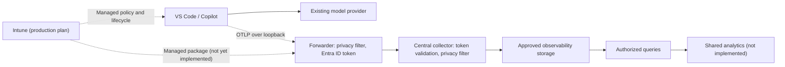

# Architecture

Status: design with reference implementations of the collector and its privacy pipeline, local quick start, client setup script and forwarder, and private Azure deployment ([infrastructure](infrastructure.md)). A [local analytics and human review application](analytics.md) reads the sanitized collector file; the authorized cloud query and shared analytics components shown below remain unimplemented.

## System boundaries

Copilot Insights observes instrumented agent activity through OpenTelemetry. It does not intercept inference traffic, alter model selection, or replace the user's model-provider subscription.

The forwarder is the same OpenTelemetry Collector as the central service, running with the [forwarder profile](../collector/config/forwarder.yaml) as the participant. It exists because Copilot's native export can neither authenticate itself with renewable credentials nor filter its own metadata. A successful test of one runtime does not establish that every runtime can use the same configuration.

## Client and forwarder

The initial qualification target is Windows VS Code using the Local harness. A harmless VS Code 1.140.0 / Copilot Chat 0.68.0 task has verified native traces, metrics, and a feedback event through the local collector and portal ([evidence](local-validation.md#native-client-emission-and-restoration)). Agent Host, terminal CLI, remote extension hosts, other versions, and other operating systems qualify independently.

Organization production configuration and package lifecycle are owned by **Microsoft Intune**, using Copilot managed telemetry policy, staged assignments, detection/remediation, and central rollback. The [production plan](intune-deployment.md) distinguishes required implementation from the diagnostic reference; the managed package and production authentication lifecycle are not yet implemented.

[setup-client.ps1](../scripts/setup-client.ps1) is for local development and controlled administrator diagnostics, not employee onboarding. Ordinary installation adds a removable user-settings block. `Install -Local -Temporary` can override existing user OTel preferences for a local test, saves the original bytes, and pairs with [restore-client.ps1](../scripts/restore-client.ps1); restoration refuses concurrent edits. Cohort/ring attributes are configuration labels, not authenticated identity or active-project context.

The current diagnostic forwarder:

- Binds only to `127.0.0.1`, on a non-default port so other local OTLP senders do not reach it by accident.
- Applies the shared allow-list and value validation before anything leaves the device.
- Removes any client-supplied organization label; the central collector assigns it.
- Obtains Entra ID tokens through the participant's Azure CLI sign-in and renews them automatically. Tokens stay inside the forwarder process, out of the editor's settings and environment, tool subprocesses, and logs.
- Has a fixed memory budget, in-memory retry queues only, and no raw telemetry persistence.
- Fails without blocking development work: if it is down, Copilot's export fails in the background.

Loopback is not proof of process identity. Another process running as the same user can send telemetry through the forwarder, and it will carry the participant's token. The privacy pipeline still applies, so this can add bogus records but not extra fields. Treat pilot data accordingly.

## Ingestion protocol

Use OTLP (the OpenTelemetry protocol) over HTTP. Copilot sends JSON by default and the forwarder sends protobuf; the receiver accepts both. The reference collector serves the standard signal paths at its root, so clients are configured with the base URL only (illustratively `https://telemetry.example.org`):

- `/v1/traces`
- `/v1/metrics`
- `/v1/logs`

The example domain is not a live endpoint. If a reverse proxy adds a path prefix, configure path rewriting explicitly and verify each signal. Do not route telemetry through a browser application, interactive login redirect, or HTML error handler.

Ingress must enforce authentication and authorization, TLS, request/decompression limits, rate limits, and valid content types. Backend receiver ports must remain private. Access and diagnostic logs must not contain credentials or request bodies.

## Authentication

An endpoint URL alone provides no client credential. Copilot does not automatically attach a collector-specific token or a browser session. Enabling identity capture adds telemetry attributes; it does not authenticate the connection.

| Option | Capability | Assessment |
|---|---|---|
| Native explicit headers | Copilot supports a `github.copilot.chat.otel.headers` setting and `OTEL_EXPORTER_OTLP_HEADERS` | A static token expires within about an hour, and settings files and environment variables are readable by other local tools. Not used. |
| Local authenticated forwarder | A separate process owns upload authentication and filtering | **Diagnostic reference implemented.** Tokens come from the executing user's Azure CLI sign-in. An approved managed identity/token lifecycle, such as a dedicated broker-backed client, is an Intune production release gate; `SYSTEM` cannot inherit that user sign-in. |
| Network restriction alone | Limits where connections can originate | Does not establish individual sender identity and does not satisfy the authenticated-ingestion requirement |

Supplying a bearer header does not implement OAuth or token refresh. A token obtained once at startup eventually expires. Do not reuse a model-provider token for a different audience or distribute one long-lived secret to every participant.

For an OAuth/OIDC design, validate signature, issuer, intended audience, lifetime, and authorized scopes/roles. Bind allowed organization/storage scope from a server-controlled enrollment mapping, not a request attribute. A valid credential authenticates an uploader, not the truth of its telemetry.

Copilot's documented managed-header behavior differs between Chat and Agent Host. Verify the selected mechanism for each runtime. A setup script or managed settings do not, by themselves, solve authentication; the forwarder does.

## Processing pipeline

Use a version-pinned, approved OpenTelemetry Collector distribution and supported processors/exporters where possible. The conceptual order is:

1. Authenticate and authorize the request at the trusted ingress boundary.
2. Decode OTLP and enforce resource and schema limits.
3. Validate field names and values across resources, scopes, spans, events, links, log bodies, and metrics.
4. Remove prohibited data and attach approved source/schema and authorization-derived context.
5. Batch and enqueue only sanitized records.
6. Export through the selected backend adapter with bounded retries.

The reference configuration implements steps 1 to 5. The `azure` profile validates Entra ID tokens (step 1), and [collector/config/base.yaml](../collector/config/base.yaml) implements steps 2 to 5 for every profile: it drops unapproved spans, metrics, and log events, keeps only allow-listed attributes, replaces string values that are not identifier-like with `redacted`, removes span events, replaces span names with the operation name, clears status messages and log bodies, and overwrites the organization label. [scripts/verify.ps1](../scripts/verify.ps1) checks this with canary values. The processors fail closed: a processing error drops the batch rather than forwarding unfiltered data.

The pipeline does not yet clear span links or metric exemplars, and it does not validate values inside arrays such as `gen_ai.response.finish_reasons`. Check for them before qualifying a client that emits them.

Source-side filtering and server filtering have different guarantees: server filtering protects retained data, while only source-side controls can prevent prohibited fields from leaving the device. The reference implementation runs the same pipeline in both places.

The Collector is a processing service, not the long-term database. Do not archive unrestricted raw payloads for hypothetical future analysis. Disable payload debugging in ingress, authentication components, and the collector.

## Storage

Keep the receiver OTLP-based and the analytics schema explicit so deployments can select an appropriate backend. A backend must meet the approved retention, access, regional hosting, deletion, and cost requirements.

### Azure Monitor reference option

The reference Azure deployment ([infrastructure](infrastructure.md)) uses the Azure Monitor exporter to upload records to a workspace-based Application Insights resource, with durable query storage in its linked Log Analytics workspace. The collector authenticates with a managed identity, local authentication is disabled, and ingestion uses a private endpoint. Clients never receive backend storage credentials.

The upstream exporter documents these mappings; verify them against the pinned release:

| OTel input | Workspace table | Important condition |
|---|---|---|
| `CLIENT`, `PRODUCER`, and `INTERNAL` spans | `AppDependencies` | Selected by span kind, not only the operation name |
| `SERVER` and `CONSUMER` spans | `AppRequests` | These describe emitted spans, not automatically the receiver's HTTP requests |
| Ordinary log records | `AppTraces` | Application Insights calls log records traces; distributed spans use other tables |
| Explicitly marked custom-event logs | `AppEvents` | Requires the exporter option and a supported marker |
| Supported metrics | `AppMetrics` | Validate units, types, cumulative/delta behavior, and histogram translation |

Do not assume a generic histogram preserves buckets or exact percentiles through translation. Verify token attributes, resource tags, and operation/parent correlations using synthetic fixtures. Generative-AI content tables must remain empty for this project's source because content collection is out of scope.

No separate relational database, raw-data object archive, or message broker is required by the initial proposal. Add infrastructure only when measured requirements justify it.

### Queues are not durable analytics storage

An in-memory sending queue can lose data on process failure. A secured persistent queue improves restart recovery but still has finite capacity, retry expiry, and disk-failure risks. Only sanitized data may enter a durable queue.

An OTLP success response is not proof that every item is already stored and queryable downstream. Respect partial-success semantics, track drops and export failures, and use a synthetic end-to-end query probe for ingestion delay. Do not promise exactly-once delivery.

## Query and dashboard boundary

The [local review workspace](analytics.md) is a separate evaluation path: a read-only collector-file projection feeds aggregate views, rule-based findings, and a local review-state volume. It is included in Compose on loopback port 3000; Aspire diagnostics remains on port 18888. It does not query Azure, import private datasets, or implement shared user authorization. Demo examples are generated independently and kept separate from collected records.

An authorized backend queries the selected store and returns aggregates. The browser must not receive storage credentials. Enforce organization/cohort authorization server-side; a filter in the UI is not an access boundary.

Display signal provenance, supported versions/runtimes, time window, last ingestion time, and gaps. Keep operational metrics separate from user activity. Avoid high-cardinality metric labels such as trace IDs, conversation IDs, paths, or free-form text.

See the [data contract](data-contract.md) for counting rules and the [rollout plan](rollout-plan.md) for evidence required before a pilot.

## References

- [Copilot OpenTelemetry monitoring](https://code.visualstudio.com/docs/agents/guides/monitoring-agents)
- [Collector architecture](https://opentelemetry.io/docs/collector/architecture/)
- [Collector resilience](https://opentelemetry.io/docs/collector/resiliency/)
- [Azure Monitor exporter](https://github.com/open-telemetry/opentelemetry-collector-contrib/tree/main/exporter/azuremonitorexporter)
- [Application Insights telemetry model](https://learn.microsoft.com/en-us/azure/azure-monitor/app/data-model-complete)
