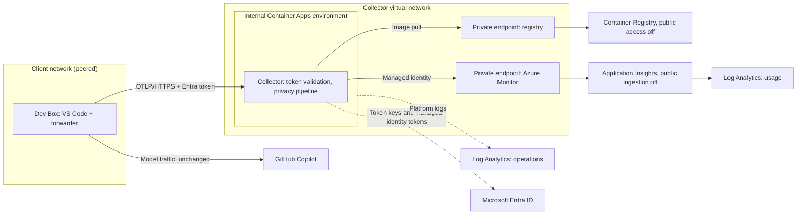

# Infrastructure

Status: reference deployment. The template in [deploy/azure](../deploy/azure) is written in [Bicep](https://learn.microsoft.com/azure/azure-resource-manager/bicep/overview), Azure's language for declaring infrastructure. It compiles and passes the Bicep linter without warnings, but the maintainers have not yet deployed it in a subscription. Validate it in a non-production subscription before onboarding users.

## Why this design

- **Private by default.** Usage telemetry is still metadata about people's work, so nothing in the path has a public endpoint: not the collector, the registry, or the storage ingestion.
- **Authenticated, not just reachable.** Network reachability does not identify a sender. The collector accepts only Entra ID tokens issued for your ingestion app, to users you assign.
- **No shared secrets for telemetry.** The collector uses a managed identity to pull its image and to write to Application Insights, which has local authentication disabled, and participants use their own sign-in. The only key in the template is the operations workspace key that Container Apps needs for platform logs.
- **Standard parts.** Container Apps, Container Registry, Application Insights, and Log Analytics are standard Azure services, and the collector is the upstream OpenTelemetry Collector image.

## Topology

Every data path between the client network, the collector, the registry, and telemetry storage uses private IP addresses. The collector has no public ingress.



## Resources

| Resource | Purpose | Private connectivity |
|---|---|---|
| Virtual network | Container Apps subnet (delegated) and private endpoint subnet | Peer client networks to it |
| Container Apps environment | Hosts the collector; workload profiles, Consumption profile | Internal: reachable only from connected networks through a static private IP |
| Container app | Collector image with the `azure` profile; ingress on port 4318, health on 13133 | VNet-scoped ingress, optional client CIDR allow-list |
| Container Registry (Premium) | Stores the collector image | Private endpoint; public access disabled unless push ranges are allowed |
| User-assigned managed identity | Pulls the image and authenticates exports | No secrets in configuration |
| Application Insights | Usage ingestion; local authentication disabled | Public ingestion disabled; reached through the private endpoint |
| Log Analytics (usage) | Durable query store for collected telemetry | Public ingestion disabled; query access configurable |
| Log Analytics (operations) | Container Apps platform and collector logs | Kept separate from usage telemetry |
| Azure Monitor Private Link Scope | Private ingestion for the workspaces and Application Insights | Open access mode, so other monitor resources reachable from the network keep working |
| Private DNS zones | Registry, Azure Monitor, and Container Apps environment names | See [DNS](#dns) |

Role assignments grant the managed identity `AcrPull` on the registry and `Monitoring Metrics Publisher` on Application Insights.

## Network paths

| Path | Private | Notes |
|---|---|---|
| Client to collector | Yes | Internal environment static IP, resolved through private DNS |
| Collector image pull | Yes | Registry private endpoint |
| Collector to Application Insights | Yes | Azure Monitor private endpoint; the resources reject public ingestion |
| Collector to Microsoft Entra ID | No | OIDC discovery, signing keys, and managed identity tokens use Entra ID endpoints, which private endpoints do not cover |
| Platform logs to the operations workspace | Platform-managed | Sent by Container Apps |
| Queries from the portal or Workbooks | Configurable | `queryPublicNetworkAccess = 'Disabled'` restricts queries to connected networks |
| Image push | Configurable | From a connected network, or from ranges temporarily listed in `registryAllowedIpRanges` |

The template does not force-tunnel egress. To route outbound traffic through a firewall, add a route table and follow the Container Apps egress requirements, keeping Entra ID reachable.

## DNS

- Registry and Azure Monitor zones link only to the collector network. Linking Azure Monitor private zones to another network changes how every Azure Monitor resource resolves from that network, so do not link them to client networks.
- The Container Apps environment zone links to the collector network and to every network in `clientVirtualNetworkIds`, so clients resolve the collector to its private IP.
- With central DNS (for example, a hub DNS Private Resolver), add equivalent records or forwarding rules there and leave `clientVirtualNetworkIds` empty.

## Prerequisites

- A resource group, and permission to create resources and role assignments in it (for example, Contributor plus Role Based Access Control Administrator).
- A client network that does not overlap `vnetAddressPrefix`, peered with the collector network after the first deployment. A Dev Box network connection that uses this client network gives Dev Boxes access.
- Azure CLI with Bicep, PowerShell 7.2 or later, and Docker (or another OCI image builder) on a machine that can reach the registry.
- An Entra ID tenant administrator to register the ingestion API.

## Register the ingestion API

The collector accepts only Entra ID v2 access tokens whose audience is this application. Run as a tenant administrator:

```powershell
$app = az ad app create --display-name 'copilot-insights-ingestion' --sign-in-audience AzureADMyOrg --query '{appId:appId,id:id}' -o json | ConvertFrom-Json
az ad app update --id $app.appId --identifier-uris "api://$($app.appId)"

$scope = @{
    id = [guid]::NewGuid().ToString(); value = 'Telemetry.Write'; type = 'User'; isEnabled = $true
    adminConsentDisplayName = 'Send Copilot telemetry'; adminConsentDescription = 'Allows the signed-in user to send telemetry to Copilot Insights.'
    userConsentDisplayName = 'Send Copilot telemetry'; userConsentDescription = 'Allows sending telemetry to Copilot Insights on your behalf.'
}
$body = Join-Path ([IO.Path]::GetTempPath()) 'copilot-insights-api.json'
@{ api = @{ requestedAccessTokenVersion = 2; oauth2PermissionScopes = @($scope) } } | ConvertTo-Json -Depth 5 | Set-Content -LiteralPath $body
az rest --method PATCH --uri "https://graph.microsoft.com/v1.0/applications/$($app.id)" --headers 'Content-Type=application/json' --body "@$body"

# Pre-authorize Azure CLI for the scope; participants' forwarders get their tokens through Azure CLI.
$azureCli = @{ appId = '04b07795-8ddb-461a-bbee-02f9e1bf7b46'; delegatedPermissionIds = @($scope.id) }
@{ api = @{ requestedAccessTokenVersion = 2; oauth2PermissionScopes = @($scope); preAuthorizedApplications = @($azureCli) } } | ConvertTo-Json -Depth 5 | Set-Content -LiteralPath $body
az rest --method PATCH --uri "https://graph.microsoft.com/v1.0/applications/$($app.id)" --headers 'Content-Type=application/json' --body "@$body"

az ad sp create --id $app.appId
az ad sp update --id $app.appId --set appRoleAssignmentRequired=true
$app.appId
```

- Use the printed application ID as `ingestionAudience`. Participants use the scope `api://<application-id>/Telemetry.Write`.
- `appRoleAssignmentRequired` means only users and groups assigned to the enterprise application can obtain tokens. Assign pilot participants under **Enterprise applications > copilot-insights-ingestion > Users and groups**.
- Pre-authorizing Azure CLI (`04b07795-8ddb-461a-bbee-02f9e1bf7b46`, a Microsoft first-party client) means participants are not asked to consent. It does not widen access: only assigned users get tokens, and only for this scope. If your organization does not allow it, participants cannot use the forwarder until a dedicated client application replaces Azure CLI.
- Token issuance authenticates the uploader. It does not prove that uploaded telemetry is accurate; the collector still enforces the data contract.

## Deploy

Deploy in two phases, because the container app needs an image in the private registry.

1. Copy [main.example.bicepparam](../deploy/azure/main.example.bicepparam) to `deploy/azure/main.bicepparam` (ignored by Git) and set `namePrefix`, `organizationId`, `ingestionAudience`, and `clientVirtualNetworkIds`. Keep `deployCollector = false`.

2. Deploy the network, registry, and storage:

   ```powershell
   az group create --name <resource-group> --location <region>
   az deployment group create --resource-group <resource-group> --name copilot-insights --parameters deploy/azure/main.bicepparam
   ```

3. Peer the client network with the collector network (`vnetId` output). Peering is outside this template because it usually crosses subscriptions or ownership boundaries.

4. Build and push the image from a machine that can reach the registry: a host in a connected network, or one whose public range you temporarily added to `registryAllowedIpRanges` and redeployed.

   ```powershell
   $outputs = az deployment group show --resource-group <resource-group> --name copilot-insights --query properties.outputs -o json | ConvertFrom-Json
   $image = "$($outputs.registryLoginServer.value)/copilot-insights-collector:0.1.0"
   docker build --tag $image collector
   az acr login --name $outputs.registryName.value
   docker push $image
   ```

5. Set `deployCollector = true`, clear any `registryAllowedIpRanges`, and run the deployment command again.

## Verify

From a machine in a connected network:

```powershell
$fqdn = ([Uri]$outputs.collectorEndpoint.value).Host
Resolve-DnsName $fqdn   # Expect the environmentStaticIp output, a private address
./scripts/verify.ps1 -Endpoint $outputs.collectorEndpoint.value -AccessTokenScope "api://<ingestion-app-id>/Telemetry.Write"
```

The script sends synthetic telemetry with canary values and prints two queries. Run them in the usage workspace after ingestion delay: the first must return the three approved operations, and the second must return zero rows. Also confirm:

- A request without a token receives HTTP 401.
- The collector endpoint does not resolve or respond from outside connected networks.
- `ContainerAppConsoleLogs_CL` in the operations workspace shows no repeated export or authentication errors.

## Connect pilot participants

Give each participant:

- The collector endpoint: the `collectorEndpoint` deployment output.
- The scope: `api://<application-id>/Telemetry.Write`.
- An assignment to the enterprise application.

They follow [Client setup](client-setup.md). Their machines need Azure CLI and a network path to the collector: a peered network whose DNS resolves the collector to `environmentStaticIp`.

Each forwarder filters telemetry on the device and authenticates with the participant's own sign-in, so nobody handles a shared secret. To revoke a participant, remove their assignment. Tokens already issued stay valid until they expire, typically within 60 to 90 minutes.

## Troubleshooting

| Symptom | Likely cause | What to check |
|---|---|---|
| Participants see `AADSTS65001` | Azure CLI is not pre-authorized | Rerun the pre-authorization step in [Register the ingestion API](#register-the-ingestion-api) |
| Participants see `AADSTS50105` | The participant is not assigned | **Enterprise applications > copilot-insights-ingestion > Users and groups** |
| Forwarder logs show HTTP 401 | Token issuer or audience mismatch | `ingestionAudience` must be the application ID, and the app must request version 2 tokens (`requestedAccessTokenVersion = 2`) |
| Forwarder logs show DNS or connection errors | No network path | From the client, the collector name must resolve to `environmentStaticIp`. Check peering, the environment DNS zone links, and `allowedClientCidrs` |
| Requests succeed but no data reaches the usage workspace | Export failure | `ContainerAppConsoleLogs_CL` for `azure_monitor` errors; the `Monitoring Metrics Publisher` assignment; Azure Monitor names resolving to private addresses from the collector network |
| The revision never becomes healthy | Image pull or configuration error | `ContainerAppSystemLogs_CL`; the registry private endpoint and the `AcrPull` assignment |

## Operations

- **Logs:** collector output is in `ContainerAppConsoleLogs_CL` and platform events in `ContainerAppSystemLogs_CL` of the operations workspace.
- **Delivery:** the export queue is in memory. A replica restart can lose queued batches; add a persistent queue before relying on the data for anything that needs completeness.
- **Updates:** build and push a new tag, update `collectorImage`, and redeploy. Run the local verification against the new image first.
- **Cost drivers:** the Premium registry and private endpoints have standing charges; Container Apps and Log Analytics charges scale with usage and retention.
- **Removal:** delete the resource group, then the app registration and any peering on the client side.

## Hardening backlog

- Build a minimal collector distribution with only the required components instead of the contrib image.
- Route egress through a firewall, and disable public query access where operators work from connected networks.
- Use `PrivateOnly` Azure Monitor access mode on dedicated networks.
- Enable zone redundancy, and add a persistent sending queue.
- Sign and publish the collector image from CI. CI currently builds and tests the image but does not publish it.
