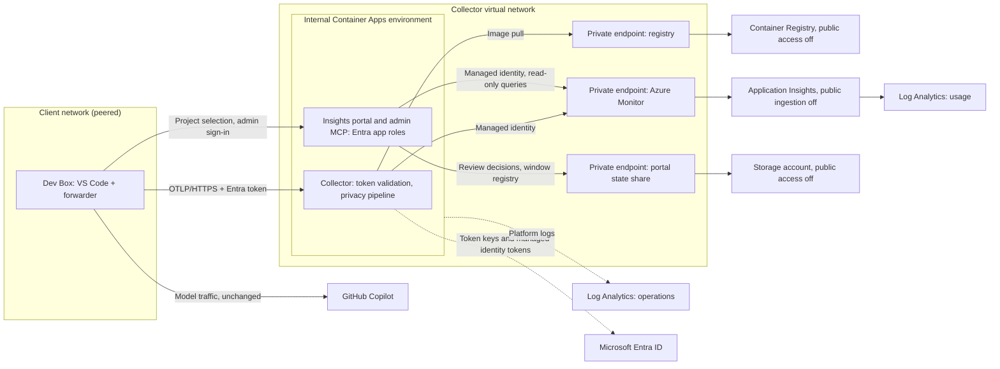

# Infrastructure

Status: **validation resources removed; end-to-end cloud ingestion not verified**. The template in [deploy/azure](../deploy/azure) is written in [Bicep](https://learn.microsoft.com/azure/azure-resource-manager/bicep/overview). The isolated deployment reached a healthy collector revision with private networking, the intended ingestion identity, and a custom-certificate binding. Target-tenant diagnostic token issuance passed, but data-plane validation did not complete. The validation resource groups and active ingestion identity were removed and verified absent on October 3, 2026. No successful cloud OTLP delivery, durable usage telemetry, or Azure-backed analytics is claimed. See the [validation scope, cleanup, and remaining gates](azure-validation.md). This is not production qualification.

**For administrators only.** Deploy the shared service once; participants use [Client setup](client-setup.md) and do not repeat these steps. To evaluate without Azure, use the [local demo](../README.md#try-it-on-your-machine).

**Organization production clients are deployed and managed through Microsoft Intune**, including policy, package lifecycle, detection/remediation, and rollback. Follow the [Intune production plan](intune-deployment.md). Its managed package, startup, and supported authentication are implementation gates, not capabilities supplied by the current manual diagnostic script.

## Setup sequence

1. Check [prerequisites](#prerequisites), then [register the ingestion app](#register-the-ingestion-api).
2. [Deploy](#deploy) the private network and storage, push the images, and enable the collector and then the insights portal.
3. [Verify](#verify) authenticated delivery all the way to storage using synthetic data. A healthy process or HTTP 200 alone is not sufficient.
4. Build and qualify the Intune-managed client and authentication lifecycle, complete the [pilot gates](rollout-plan.md#acceptance-criteria), then [assign the approved rollout ring](#organization-deployment-with-intune).

The topology and DNS sections below explain the deployment choices; they are not extra participant setup steps. The Premium registry and private endpoints incur charges even when no telemetry is sent.

## Why this design

- **Private by default.** Usage telemetry is still metadata about people's work, so nothing in the path has a public endpoint: not the collector, the registry, or the storage ingestion.
- **Authenticated, not just reachable.** Network reachability does not identify a sender. The collector accepts only Entra ID tokens issued for your ingestion app, to users you assign.
- **No shared secrets for telemetry.** The collector uses a managed identity to pull its image and to write to Application Insights, which has local authentication disabled, and participants use their own sign-in. The portal uses its own managed identity to read the usage workspace. The only keys in the template are the operations workspace key that Container Apps needs for platform logs and the storage account key Container Apps needs to mount the portal's private state share.
- **Standard parts.** Container Apps, Container Registry, Application Insights, and Log Analytics are standard Azure services, and the collector is the upstream OpenTelemetry Collector, packaged with the portal in one image.

## Topology

Every data path between the client network, the collector, the registry, and telemetry storage uses private IP addresses. The collector has no public ingress.



## Resources

| Resource | Purpose | Private connectivity |
|---|---|---|
| Virtual network | Container Apps subnet (delegated) and private endpoint subnet | Peer client networks to it |
| Container Apps environment | Hosts the collector and portal apps; workload profiles, Consumption profile | Internal: reachable only from connected networks through a static private IP |
| Container app (collector) | The Copilot Insights image in the `collector` role with the `azure` profile; ingress on port 4318, health on 13133 | VNet-scoped ingress, optional client CIDR allow-list |
| Container app (insights, when `deployInsights = true`) | The same image in the `portal` role: portal, project registration, and admin MCP in Entra production mode; queries the usage workspace; one replica | VNet-scoped HTTPS ingress, same client CIDR allow-list |
| Storage account and file share (with the portal) | Review decisions and the window-to-project registry | Private endpoint; public network access disabled |
| Container Registry (Premium) | Stores the Copilot Insights image | Private endpoint; public access disabled unless push ranges are allowed |
| User-assigned managed identities | Collector: pulls its image and authenticates exports. Portal: pulls its image and queries the usage workspace | No secrets in configuration |
| Application Insights | Usage ingestion; local authentication disabled | Public ingestion disabled; reached through the private endpoint |
| Log Analytics (usage) | Durable query store for collected telemetry | Public ingestion disabled; query access configurable |
| Log Analytics (operations) | Container Apps platform and collector logs | Kept separate from usage telemetry |
| Azure Monitor Private Link Scope | Private ingestion for the workspaces and Application Insights | Open access mode, so other monitor resources reachable from the network keep working |
| Private DNS zones | Registry, Azure Monitor, file storage, and Container Apps environment names | See [DNS](#dns) |

Role assignments grant the collector identity `AcrPull` on the registry and `Monitoring Metrics Publisher` on Application Insights, and the portal identity `AcrPull` and `Log Analytics Reader` on the usage workspace.

## Network paths

| Path | Private | Notes |
|---|---|---|
| Client to collector | Yes | Internal environment static IP, resolved through private DNS |
| Image pull | Yes | Registry private endpoint |
| Collector to Application Insights | Yes | Azure Monitor private endpoint; the resources reject public ingestion |
| Clients and administrators to the portal | Yes | Same internal environment static IP and private DNS as the collector |
| Portal to the usage workspace | Yes | Azure Monitor private endpoint, read-only `Log Analytics Reader` role |
| Portal to its state share | Yes | File private endpoint; the storage account rejects public access |
| Collector to Microsoft Entra ID | No | OIDC discovery, signing keys, and managed identity tokens use Entra ID endpoints, which private endpoints do not cover |
| Platform logs to the operations workspace | Platform-managed | Sent by Container Apps |
| Queries from the portal or Workbooks | Configurable | `queryPublicNetworkAccess = 'Disabled'` restricts queries to connected networks |
| Image push | Configurable | From a connected network, or from ranges temporarily listed in `registryAllowedIpRanges` |

The template does not force-tunnel egress. To route outbound traffic through a firewall, add a route table and follow the Container Apps egress requirements, keeping Entra ID reachable.

## DNS

- Registry and Azure Monitor zones link only to the collector network. Linking Azure Monitor private zones to another network changes how every Azure Monitor resource resolves from that network, so do not link them to client networks.
- The Container Apps environment zone links to the collector network and to every network in `clientVirtualNetworkIds`, so clients resolve the collector to its private IP.
- With central DNS (for example, a hub DNS Private Resolver), add equivalent records or forwarding rules there and leave `clientVirtualNetworkIds` empty.

## Prerequisites

- A resource group, and permission to create resources and role assignments in it (for example, Contributor plus Role Based Access Control Administrator).
- A client network that does not overlap `vnetAddressPrefix`, peered with the collector network after the first deployment. A Dev Box network connection that uses this client network gives Dev Boxes access.
- Azure CLI with Bicep, PowerShell 7.2 or later, and Docker (or another OCI image builder) on a machine that can reach the registry.
- An Entra ID tenant administrator to register the ingestion API.
- Endpoint administrators with Intune-enrolled test devices and permission to manage Win32 apps, managed policy, assignment groups, and rollback before any organization client rollout.

## Register the ingestion API

The reference collector uses Entra ID v2 access tokens whose audience is this application. Run the following reference registration as a tenant administrator in the validation environment. Its Azure CLI pre-authorization supports controlled administrator probes only; production client registration, consent, and token lifecycle must be completed under the [Intune authentication gate](intune-deployment.md#authentication-release-gate).

**Select the directory explicitly.** A subscription parameter on an ARM deployment does not select the tenant for every directory operation. In the tested Azure CLI, raw `az rest` calls to Microsoft Graph used the default directory even when `--subscription` was supplied. Obtain a Graph credential with `az account get-access-token --tenant` and use it explicitly, as below; do not change the operator's default account or assume a failed target-tenant token request means the application needs time to propagate. Check the actual registration in that tenant before retrying creation.

If tenant policy requires a service-ownership reference (for example, registration returns `ServiceTreeValueMissing`), obtain the approved value from the application owner and populate the optional [`serviceManagementReference` property](https://learn.microsoft.com/graph/api/resources/application#properties), or use an approved existing ingestion registration. Do not invent or borrow another application's ownership reference, change tenant policy, or disable ingestion authentication. ARM and the one-click template do not create this registration. Keep real IDs and ownership references in private deployment records, not this repository.

```powershell
$ErrorActionPreference = 'Stop'
$subscriptionId = '<deployment-subscription-id>'
$tenantId = az account show --subscription $subscriptionId --query tenantId -o tsv
if ($LASTEXITCODE -ne 0 -or -not $tenantId) { throw 'Cannot resolve the deployment tenant.' }
$graphCredential = az account get-access-token --tenant $tenantId --resource https://graph.microsoft.com -o json | ConvertFrom-Json
if ($LASTEXITCODE -ne 0 -or $graphCredential.tenant -ne $tenantId) { throw 'Graph credential tenant mismatch.' }
$graphHeaders = @{ Authorization = "Bearer $($graphCredential.accessToken)" }
$serviceOwnershipReference = ''
$registration = @{ displayName = 'copilot-insights-ingestion'; signInAudience = 'AzureADMyOrg' }
if ($serviceOwnershipReference) { $registration.serviceManagementReference = $serviceOwnershipReference }
$app = Invoke-RestMethod -Method Post -Uri 'https://graph.microsoft.com/v1.0/applications' -Headers $graphHeaders -ContentType 'application/json' -Body ($registration | ConvertTo-Json)
$app.appId

$scope = @{
    id = [guid]::NewGuid().ToString(); value = 'Telemetry.Write'; type = 'Admin'; isEnabled = $true
    adminConsentDisplayName = 'Send Copilot telemetry'; adminConsentDescription = 'Allows the signed-in user to send telemetry to Copilot Insights.'
}
$writerRole = @{
    id = [guid]::NewGuid().ToString(); value = 'Telemetry.Writer'; displayName = 'Telemetry writer'
    description = 'Assigned diagnostic telemetry sender.'; allowedMemberTypes = @('User'); isEnabled = $true
}
$body = @{ identifierUris = @("api://$($app.appId)"); appRoles = @($writerRole); api = @{ requestedAccessTokenVersion = 2; oauth2PermissionScopes = @($scope) } } | ConvertTo-Json -Depth 8
Invoke-RestMethod -Method Patch -Uri "https://graph.microsoft.com/v1.0/applications/$($app.id)" -Headers $graphHeaders -ContentType 'application/json' -Body $body

$azureCli = @{ appId = '04b07795-8ddb-461a-bbee-02f9e1bf7b46'; delegatedPermissionIds = @($scope.id) }
$body = @{ api = @{ requestedAccessTokenVersion = 2; oauth2PermissionScopes = @($scope); preAuthorizedApplications = @($azureCli) } } | ConvertTo-Json -Depth 8
Invoke-RestMethod -Method Patch -Uri "https://graph.microsoft.com/v1.0/applications/$($app.id)" -Headers $graphHeaders -ContentType 'application/json' -Body $body

$body = @{ appId = $app.appId; appRoleAssignmentRequired = $true } | ConvertTo-Json
Invoke-RestMethod -Method Post -Uri 'https://graph.microsoft.com/v1.0/servicePrincipals' -Headers $graphHeaders -ContentType 'application/json' -Body $body
Remove-Variable graphCredential, graphHeaders
```

- Use the printed application ID as `ingestionAudience`. The diagnostic forwarder requests the scope `api://<application-id>/Telemetry.Write`.
- Assign only approved diagnostic operators to the **Telemetry writer** role under **Enterprise applications > copilot-insights-ingestion > Users and groups** before requesting tokens. `appRoleAssignmentRequired` restricts issuance to assigned principals; the current collector's OIDC extension validates issuer/audience, not a separate arbitrary scope/role authorization policy. Production client authorization remains a release gate.
- Azure CLI pre-authorization is for approved diagnostic accounts, not a dependency to distribute to employees. Review consent and assignments with the identity owner. If it is disallowed, stop those probes rather than bypassing policy; implement the approved production client identity separately.
- Token issuance authenticates the uploader. It does not prove that uploaded telemetry is accurate; the collector still enforces the data contract.

## Deploy

Deploy in two phases, because the container app needs an image in the private registry. Run commands from the repository folder in PowerShell 7, replacing angle-bracket placeholders with your values before execution.

### Deploy to Azure button

[](https://portal.azure.com/#create/Microsoft.Template/uri/https%3A%2F%2Fraw.githubusercontent.com%2Fmicrosoft%2Fcopilot-insights%2Fmain%2Fdeploy%2Fazure%2Fazuredeploy.json)

The button follows the [microsoft/mcp-gateway deployment guide](https://github.com/microsoft/mcp-gateway#3-deploy-service-resources) and Microsoft's [Deploy to Azure button format](https://learn.microsoft.com/azure/azure-resource-manager/templates/deploy-to-azure-button): a portal `Microsoft.Template/uri/` link containing the URL-encoded **raw ARM JSON** URL. The generated [azuredeploy.json](../deploy/azure/azuredeploy.json) includes its nested DNS templates and does not download configuration or execute source from another repository. The portal cannot deploy Bicep directly through this button.

Before clicking, obtain the approved ingestion application/client ID and tenant, permission to create resources and role assignments, a non-overlapping network range, and an agreed private client connection. Select the intended subscription and **Create new** resource group in the portal. Set the organization label and ingestion audience, leave `deployCollector = false`, and review the chargeable resources. Complete image publication and collector activation below; infrastructure success does not mean telemetry is flowing.

**Published template only:** the button loads the raw JSON from the repository's default branch, which is reachable only while the repository is public and never includes unpublished changes. Its live deployment has not been verified. To deploy a private or modified checkout, run the local commands below or open Azure portal **Deploy a custom template > Build your own template in the editor > Load file** and select `deploy/azure/azuredeploy.json`. For a fork or immutable release, URL-encode that repository/ref's raw JSON URL instead. Do not publish deployment parameters or certificates with the template.

Regenerate the artifact with `./scripts/export-azure-template.ps1` after editing Bicep; `./scripts/export-azure-template.ps1 -Check` verifies freshness in CI. For source-change validation, build the collector from the same checkout rather than assuming a published image includes your work.

### Azure-hosted deployment link

For a private or not-yet-published checkout, an administrator can store **only the generic template** as an [Azure Template Spec](https://learn.microsoft.com/azure/azure-resource-manager/bicep/template-specs#deploy-template-spec). This provides a versioned, RBAC-protected portal deployment link without publishing source changes or private parameters to GitHub. The isolated validation run created such a copy and checked that its JSON values match the checked-out artifact, then successfully ran Azure provider validation against it. That lab copy was [deleted with the validation resource group](azure-validation.md#retention-and-cleanup) on October 3, 2026; its private link is no longer live. A new Template Spec requires a new approved resource group. Opening its link in a browser requires Azure sign-in; the full interactive portal form was not tested in that run.

```powershell
$subscriptionId = '<subscription-id>'
$templateResourceGroup = '<resource-group-for-template-artifacts>'
$location = '<region>'
$version = '0.1.0'
./scripts/export-azure-template.ps1 -Check
az ts create --subscription $subscriptionId --resource-group $templateResourceGroup --name copilot-insights --version $version --location $location --template-file deploy/azure/azuredeploy.json --output none
if ($LASTEXITCODE -ne 0) { throw 'Template Spec creation failed.' }
$specVersionId = az ts show --subscription $subscriptionId --resource-group $templateResourceGroup --name copilot-insights --version $version --query id --output tsv
if ($LASTEXITCODE -ne 0) { throw 'Template Spec could not be read.' }
$deployLink = 'https://portal.azure.com/#create/Microsoft.Template/templateSpecVersionId/' + [Uri]::EscapeDataString($specVersionId)
Write-Output $deployLink
```

Share that link with authorized deployment administrators, not as an employee enrollment flow. Readers need permission to read the spec and to create the target resources/role assignments; the link itself grants no access. Keep actual subscription IDs and generated links in private deployment records rather than this open-source repository. Create a new version for reviewed template changes. Deleting the spec or its resource group invalidates the link. This still deploys **infrastructure first**; it does not bypass the identity, image, network, or Intune release gates.

### Deploy from your checkout

1. Copy [main.example.bicepparam](../deploy/azure/main.example.bicepparam) to `deploy/azure/main.bicepparam` (ignored by Git) and set `namePrefix`, `organizationId`, `ingestionAudience`, and `clientVirtualNetworkIds`. Keep `deployCollector = false`.

2. Deploy the network, registry, and storage:

   ```powershell
    az group create --name '<resource-group>' --location '<region>'
    az deployment group create --resource-group '<resource-group>' --name copilot-insights --parameters deploy/azure/main.bicepparam
   ```

3. Peer the client network with the collector network (`vnetId` output). Peering is outside this template because it usually crosses subscriptions or ownership boundaries.

4. Put the Copilot Insights image into the private registry. To use a [published release](https://github.com/microsoft/copilot-insights/releases), import it; the registry's trusted-service bypass lets Azure pull it without opening public access:

   ```powershell
   $outputs = az deployment group show --resource-group '<resource-group>' --name copilot-insights --query properties.outputs -o json | ConvertFrom-Json
   $version = '<release-version>'   # for example 0.1.0, without the leading v
   az acr import --name $outputs.registryName.value --source "ghcr.io/microsoft/copilot-insights:$version" --image "copilot-insights:$version"
   ```

   To deploy your own changes instead, build and push from a machine that can reach the registry: a host in a connected network, or one whose public range you temporarily added to `registryAllowedIpRanges` and redeployed.

   ```powershell
   $image = "$($outputs.registryLoginServer.value)/copilot-insights:0.1.0"
   docker build --tag $image .
   az acr login --name $outputs.registryName.value
   docker push $image
   ```

   Set `containerImage` to the tag you imported or pushed. The collector and portal apps both run it, in the `collector` and `portal` roles.

5. Set `deployCollector = true`, clear any `registryAllowedIpRanges`, and run the deployment command again.

6. Register the portal's API and browser applications as described in [production access](production-access.md#1-register-the-api). Use the `insightsRedirectUri` output as the SPA redirect URI; it is known after the first phase. Set `deployInsights = true`, `insightsApiClientId`, `insightsPortalClientId`, and optionally `organizationName`, then run the deployment command again. Assign administrators `Insights.Admin` and contributors `Insights.Publisher`.

The `collectorDeployed` and `insightsDeployed` outputs distinguish infrastructure-only from enabled deployments. `collectorEndpoint` and `insightsEndpoint` are the **intended private addresses**; they are not health checks. Administrators open `insightsEndpoint` from a connected network and sign in. Point the [project companion](projects.md) at the same origin with `copilotInsights.authentication = entra`.

The portal reads the collector's export from the usage workspace (`AppDependencies`, `AppRequests`, `AppTraces`, `AppMetrics`) through its managed identity, using the [same counting rules](analytics.md#counting-rules-and-limits) as the local file. Results are cached for one minute and limited to the last 32 days. A query that hits a Log Analytics row, size, or time limit fails closed instead of showing partial totals. The mapping is checked against the pinned exporter's documented behavior with tests, but **has not been verified against a live workspace**; repeat the [verification](#verify) and compare the portal totals with the stored rows before relying on them.

### Development HTTPS certificate

**Windows-only development lab; not an employee rollout instruction.** Current-user certificate management does not require elevation. The default Container Apps hostname already has platform TLS. To test a custom private hostname with a short-lived self-signed certificate, use [manage-dev-certificate.ps1](../scripts/manage-dev-certificate.ps1):

```powershell
$certificate = ./scripts/manage-dev-certificate.ps1 New -Name azure-validation -DnsName collector.example.test,localhost -ValidDays 7
./scripts/manage-dev-certificate.ps1 Trust -Name azure-validation
./scripts/manage-dev-certificate.ps1 Status -Name azure-validation
```

The helper generates an RSA-3072/SHA-256 server certificate with exact DNS SANs (no wildcards), writes a password-protected PFX and public CER/PEM to a current-user-protected directory under `%LOCALAPPDATA%\CopilotInsights\Certificates`, and protects the password with Windows DPAPI. It rejects source-controlled or junction/symlink storage paths and refuses to overwrite an existing certificate. `New` **does not trust it**. `Trust` adds only the public certificate to **CurrentUser\Root**, not machine-wide trust; if Windows asks, verify the printed thumbprint before accepting. A declined or policy-blocked import is not success. The PEM is public trust material; the PFX and DPAPI password file are private.

For a **new lab deployment**, supply the certificate through secure ARM parameters. Fill in the non-secret values below with your own approved identity and deployment choices; do not use another service's ownership ID to bypass tenant registration policy.

```powershell
$subscriptionId = '<subscription-id>'
$resourceGroup = '<new-lab-resource-group>'
$certificate = ./scripts/manage-dev-certificate.ps1 Status -Name azure-validation
$password = (Get-Content -Raw -LiteralPath $certificate.ProtectedPasswordPath).Trim() | ConvertTo-SecureString
$parametersFile = Join-Path (Split-Path -Parent $certificate.PfxPath) 'deployment.parameters.json'
try {
    $parameters = @{
        '$schema' = 'https://schema.management.azure.com/schemas/2019-04-01/deploymentParameters.json#'
        contentVersion = '1.0.0.0'
        parameters = @{
            namePrefix = @{ value = '<prefix>' }
            organizationId = @{ value = '<organization-label>' }
            ingestionAudience = @{ value = '<approved-ingestion-app-id>' }
            deployCollector = @{ value = $false }
            collectorHostname = @{ value = 'collector.example.test' }
            tlsCertificateData = @{ value = [Convert]::ToBase64String([IO.File]::ReadAllBytes($certificate.PfxPath)) }
            tlsCertificatePassword = @{ value = [Net.NetworkCredential]::new('', $password).Password }
        }
    }
    $parameters | ConvertTo-Json -Depth 8 | Set-Content -LiteralPath $parametersFile
    az deployment group create --subscription $subscriptionId --resource-group $resourceGroup --name copilot-insights --template-file deploy/azure/main.bicep --parameters "@$parametersFile" --query properties.provisioningState
    if ($LASTEXITCODE -ne 0) { throw 'Azure deployment failed; inspect the deployment operations.' }
} finally {
    if (Test-Path -LiteralPath $parametersFile) { Remove-Item -LiteralPath $parametersFile }
    $password.Dispose()
    Remove-Variable parameters -ErrorAction SilentlyContinue
}
```

The template uploads the certificate to the Container Apps environment, creates a private DNS zone for the exact hostname, and binds it when `deployCollector = true`. Keep the same TLS and network parameters in both phases and subsequent deployments; omitting the hostname removes the binding from the app's desired configuration. The secure parameters are not deployment outputs. Never print, commit, or paste the generated parameter file into an issue. Rotate before expiry.

Trust and network access are separate: the private hostname still needs DNS and a route from the test machine. Windows trust does **not** automatically update Linux containers or every collector/Node/Python trust store. Configure the public PEM explicitly in those clients' supported CA settings; verify hostname/SNI and certificate validation in the actual client. Do not use `-k`, `insecure_skip_verify`, or disable TLS checks.

To reverse local trust without affecting unrelated certificates:

```powershell
./scripts/manage-dev-certificate.ps1 Untrust -Name azure-validation
./scripts/manage-dev-certificate.ps1 Remove -Name azure-validation -WhatIf
./scripts/manage-dev-certificate.ps1 Remove -Name azure-validation
```

`Untrust` removes only trust added by this helper. `Remove` also removes the tracked personal certificate/private key and the generated files; it does not remove an Azure binding or a certificate already uploaded to Azure. Remove the lab binding/certificate or delete the isolated resource group separately. Do not delete a certificate still used by an application. Production uses approved, renewable certificates and centrally managed trust; organization client configuration and trust distribution remain part of the **Intune** deployment plan, not scripts every employee runs.

## Verify

From an approved administrator's machine in a connected network, with the intended tenant selected explicitly:

```powershell
$fqdn = ([Uri]$outputs.collectorEndpoint.value).Host
Resolve-DnsName $fqdn   # Expect the environmentStaticIp output, a private address
./scripts/verify.ps1 -Endpoint $outputs.collectorEndpoint.value -TenantId '<ingestion-tenant-id>' -AccessTokenScope "api://<ingestion-app-id>/Telemetry.Write"
```

The script requires HTTPS, refuses redirects and wrong-tenant credentials, and does not change the CLI default account. It sends synthetic telemetry with canary values and prints storage queries. After ingestion delay, require all three approved span operations, all four fixture metric families, one retained feedback log, and zero canary rows. An empty workspace is not a passing privacy check. Also confirm:

- A request without a token receives HTTP 401.
- The collector endpoint does not resolve or respond from outside connected networks.
- `ContainerAppConsoleLogs_CL` in the operations workspace shows no repeated export or authentication errors.
- With the portal enabled, an assigned administrator sees the synthetic spans as **Verification-tagged spans** under **Data quality**, with the same call, tool, and token counts as the stored rows. A user without `Insights.Admin` receives HTTP 403 from the report APIs.

## Organization deployment with Intune

After service verification and pilot approval, endpoint administrators use the [Intune production plan](intune-deployment.md) to deploy the qualified package and full Copilot managed telemetry baseline to the lab group, then the approved pilot group. Employees do not run repository setup, `az login`, or startup scripts.

- Keep the native client pointed at the on-device loopback forwarder. Configure the approved private upstream and identity lifecycle through the managed package, not exporter credentials in policy or user settings.
- Verify the correct installer/runtime contexts, automatic startup after reboot/sign-in, detection/remediation, native signal provenance, and durable stored-data delivery before promotion. An Intune install success alone is insufficient.
- Check private connectivity centrally: the collector must resolve to `environmentStaticIp` from enrolled devices. Do not ask employees to edit collector YAML, DNS, or endpoints.
- Publish the [managed client guide](client-setup.md), approved collection notice, network requirements, reload timing, support contact, and pause/removal process. The local portal is not an authenticated shared analytics service.
- Perform upgrades and removal through assignment/policy changes. Demonstrate rollback before expanding the group; preserve unrelated settings and policy.

The current forwarder uses per-user Azure CLI delegated tokens and manual startup. Simply wrapping `setup-client.ps1` in Intune and running it as `SYSTEM` is not supported production authentication or lifecycle management. Packaging and the replacement/supported credential flow remain blocking work.

Keep identity enrollment aligned with managed assignments. Already-issued tokens can remain valid until expiry, so immediate incident containment needs rejection at ingestion rather than waiting for an Intune check-in or asking a user to stop a process.

## Troubleshooting

| Symptom | Likely cause | What to check |
|---|---|---|
| Administrator's Azure CLI probe sees `AADSTS65001` | Diagnostic consent/pre-authorization is missing | Identity administrator reviews the lab registration; this is not the production client enrollment flow |
| Client sees `AADSTS50105` | Enrollment/assignment mismatch | Identity and endpoint administrators check enterprise application and Intune group assignments |
| Intune reports missing or unhealthy client | Package, policy, execution-context, or lifecycle failure | Check managed detection/remediation and the package manifest; do not send employees a setup command |
| Forwarder logs show HTTP 401 | Token issuer or audience mismatch | `ingestionAudience` must be the application ID, and the app must request version 2 tokens (`requestedAccessTokenVersion = 2`) |
| Forwarder logs show DNS or connection errors | No network path | From the client, the collector name must resolve to `environmentStaticIp`. Check peering, the environment DNS zone links, and `allowedClientCidrs` |
| Requests succeed but no data reaches the usage workspace | Export failure | `ContainerAppConsoleLogs_CL` for `azure_monitor` errors; the `Monitoring Metrics Publisher` assignment; Azure Monitor names resolving to private addresses from the collector network |
| The revision never becomes healthy | Image pull or configuration error | `ContainerAppSystemLogs_CL`; the registry private endpoint and the `AcrPull` assignment |

## Operations

- **Managed clients:** use Intune deployment/health reports and the versioned manifest for promotion, remediation, and rollback; see the [client lifecycle](intune-deployment.md#client-package-and-lifecycle).
- **Logs:** collector output is in `ContainerAppConsoleLogs_CL` and platform events in `ContainerAppSystemLogs_CL` of the operations workspace.
- **Delivery:** the export queue is in memory. A replica restart can lose queued batches; add a persistent queue before relying on the data for anything that needs completeness.
- **Updates:** build and push a new tag, update `containerImage`, and redeploy. Run the local verification against the new image first.
- **Cost drivers:** the Premium registry and private endpoints have standing charges; Container Apps and Log Analytics charges scale with usage and retention.
- **Removal:** delete the resource group, then the app registration and any peering on the client side.

## Hardening backlog

- Build a minimal collector distribution with only the required components instead of the contrib binary.
- Route egress through a firewall, and disable public query access where operators work from connected networks.
- Use `PrivateOnly` Azure Monitor access mode on dedicated networks.
- Enable zone redundancy, and add a persistent sending queue.
- Sign the published image. Tagged releases publish it to GitHub Container Registry with provenance and SBOM attestations, but without signatures.
